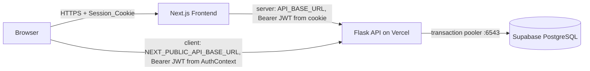

# Design Document

## Overview

RevoTask is a Trello-like task manager made of two deployables.

- **Backend**: Flask REST API (SQLAlchemy, Flask-Migrate, Flask-JWT-Extended, Marshmallow, PostgreSQL, Gunicorn locally) on Vercel as a Python function, with PostgreSQL on Supabase.
- **Frontend**: Next.js App Router application (React, TypeScript, Tailwind CSS, react-hot-toast) on Vercel.

Code examples use Python for the Backend and TypeScript for the Frontend.

Key design decisions:

| Decision | Choice | Reason |
|---|---|---|
| Card and Column ordering | `db.Column(db.Float)` order value | A move writes one row (R4.5, R30.5). The new order is the midpoint of the neighbours. |
| Deletion of Cards | Soft delete with `deleted_at` | R4.4 requires exclusion from later responses. |
| Response format | Envelope `{"data": ...}` / `{"error": "..."}` | R11.3. One error handler produces every error. |
| Layering | `app/blueprints/<name>/routes.py` → `service.py` → models; `schema.py` for validation | R11.1, R11.2, R11.4. Matches the folder paths in the brief and rubric. |
| Access control | `board_members` table with role `admin` or `member`; one helper `require_member(board_id, user_id, admin=False)` | R31. The brief names two roles (members and administrators); ownership alone cannot express them. |
| Auth state on Frontend | JWT in an `HttpOnly` Session_Cookie set by a Server Action, mirrored into AuthContext by the root layout | R32. Server Components (/ and /boards/[id]) need the JWT on the server, and the Kanban reload check (R14.6, R26.3 step 7) needs the session to survive a reload. Never written to localStorage (R21.8). |
| Route guard | Next.js 16 `proxy.ts` (formerly `middleware.ts`) reading the Session_Cookie | R12.6, R32.6. Redirects before render, so protected pages never flash. |
| Drag and drop | Native HTML5 events, optimistic update, plus a Move_Control that reuses the same move function | R15, R33. HTML5 drag events do not fire on touch screens, so the Move_Control keeps card moves usable on mobile (R27.5). |
| Visual language | "Sea glass" glassmorphism: three surface levels, one curved Sidebar as the signature element, native platform primitives (`<dialog>`, `popover`, View Transitions, `@starting-style`) with fallbacks | R34–R39. Native primitives give focus handling, top-layer rendering and Escape for free; see "UI/UX Design System". |

### Delivery ordering constraint (guidelines first)

R23.6 requires the Guideline_Set (`/guidelines/frontend.md`, `backend.md`, `database.md`) to be committed before any Backend or Frontend code. The Repository history must follow this order:

1. `specs`: `/specs` files and `.gitignore`.
2. `guidelines`: `/guidelines` files, including the before/after AI output comparison and the violation report (at least 3 violations).
3. `backend`: first commit with Backend code. It must come after commit 2.
4. `frontend`: first commit with Frontend code. It must come after commit 2.
5. `tests`, then `deployment` and README.

No file under `backend/` or `frontend/` may be added in commits 1 and 2. This can be verified with `git log --diff-filter=A --format=%H -- backend frontend` and comparing the first result against the guidelines commit.

## Architecture



Backend layout (paths match the brief and rubric exactly):

```
backend/
  app/
    __init__.py          # create_app, CORS, JWT, error handlers, GET /api/health
    extensions.py        # db, migrate, jwt
    models/              # User, Board, BoardMember, Column, Card, Comment, Notification
    common/              # envelope.py, errors.py, access.py
    blueprints/
      auth/ boards/ columns/ cards/ comments/ notifications/ analytics/ users/
        __init__.py  routes.py  service.py  schema.py
  migrations/
  tests/
  wsgi.py                # gunicorn wsgi:app
  requirements.txt  .env.example  Procfile
```

Frontend layout (Next.js App Router, no `src/` folder so `components/shared/`, `hooks/` and `lib/` sit at the project root as the brief names them):

```
frontend/
  proxy.ts                     # route guard (R12.6, R32.6); Next.js 16 renamed middleware.ts
  app/
    globals.css                # Design_Tokens (@theme), themes, glass utilities, fallbacks, motion
    fonts.ts                   # next/font: Fraunces (headings), Figtree (UI)
    layout.tsx                 # reads Session_Cookie + revotask_prefs, AuthProvider, PrefsProvider, Toaster
    (auth)/layout.tsx          # full-bleed background + centred glass card, no shell
    (auth)/login/page.tsx      # /login       (Client Component)
    (auth)/register/page.tsx   # /register    (Client Component)
    (app)/layout.tsx           # AppShell: Sidebar / Nav_Drawer + Top_Bar + main
    (app)/page.tsx             # /            (Server Component)
    (app)/boards/[id]/page.tsx # /boards/[id] (Server Component)
    (app)/my-tasks/page.tsx    # /my-tasks    (Client Component)
    (app)/profile/page.tsx     # /profile     (Client Component)
    actions/session.ts         # Server Actions createSession, deleteSession
    actions/prefs.ts           # Server Action setPrefs (writes revotask_prefs)
  components/
    shared/                    # BaseButton.tsx BaseBadge.tsx BaseModal.tsx
    layout/                    # AppBackground AppShell Sidebar NavTree NavDrawer TopBar ProfileCapsule ProfileMenu Avatar
    board/                     # KanbanBoard ColumnView CardItem MoveControl DropPlaceholder AnalyticsPanel MembersPanel
    profile/                   # ProfileHero ProfileForm
    CardDetailModal.tsx  CommentList.tsx  NotificationBell.tsx
  hooks/                       # useDragAndDrop.ts useNotifications.ts useErrorHandler.ts useDebouncedValue.ts
                               # usePreferences.ts useSpecularHighlight.ts useMenuKeyboard.ts
  lib/                         # apiClient.ts errors.ts toast.ts order.ts session.ts
                               # prefs.ts avatar.ts viewTransition.ts polyfills.ts
  context/                     # AuthContext.tsx PrefsContext.tsx
  e2e/                         # Playwright specs (auth, kanban, visual)
  .env.example
```

## Routes and Pages

### Backend routes

All routes are under `/api`. "JWT" means `@jwt_required()`.

| # | Method and path | Blueprint | JWT | Success | Error statuses |
|---|---|---|---|---|---|
| B1 | POST /api/auth/register | auth | no | 201 User | 400, 409 |
| B2 | POST /api/auth/login | auth | no | 200 `{token, expires_at, user}` | 400, 401 |
| B3 | POST /api/boards | boards | yes | 201 Board (creator becomes admin) | 400, 401 |
| B4 | GET /api/boards | boards | yes | 200 Board list with `role` | 401 |
| B5 | GET /api/boards/<id> | boards | member | 200 Board with Columns and Cards | 401, 403, 404 |
| B6 | PATCH /api/boards/<id> | boards | admin | 200 Board | 400, 401, 403, 404 |
| B7 | DELETE /api/boards/<id> | boards | admin | 200 | 401, 403, 404 |
| B8 | POST /api/boards/<id>/columns | columns | member | 201 Column | 400, 401, 403, 404 |
| B9 | PATCH /api/boards/<id>/columns/reorder | columns | member | 200 Column list | 400, 401, 403, 404 |
| B10 | PATCH /api/columns/<id> | columns | member | 200 Column | 400, 401, 403, 404 |
| B11 | DELETE /api/columns/<id> | columns | member | 200 | 401, 403, 404 |
| B12 | POST /api/columns/<id>/cards | cards | member | 201 Card | 400, 401, 403, 404 |
| B13 | GET /api/cards?assignee=me or ?search=<term> | cards | yes | 200 Card list with `board_id`, `board_name` | 400, 401 |
| B14 | PATCH /api/cards/<id> | cards | member | 200 Card | 400, 401, 403, 404 |
| B15 | DELETE /api/cards/<id> | cards | member | 200 | 401, 403, 404 |
| B16 | PATCH /api/cards/<id>/position | cards | member | 200 Card | 400, 401, 403, 404 |
| B17 | POST /api/cards/<id>/comments | comments | member | 201 Comment | 400, 401, 403, 404 |
| B18 | GET /api/cards/<id>/comments | comments | member | 200 Comment list | 401, 403, 404 |
| B19 | PATCH /api/comments/<id> | comments | yes | 200 Comment | 400, 401, 403, 404 |
| B20 | DELETE /api/comments/<id> | comments | yes | 200 | 401, 403, 404 |
| B21 | GET /api/notifications?page&per_page | notifications | yes | 200 page | 400, 401 |
| B22 | PATCH /api/notifications/<id>/read | notifications | yes | 200 Notification | 401, 403, 404 |
| B23 | GET /api/boards/<id>/analytics | analytics | admin | 200 statistics | 401, 403, 404 |
| B24 | GET /api/users/me | users | yes | 200 profile | 401 |
| B25 | PATCH /api/users/me | users | yes | 200 profile | 400, 401, 409 |
| B26 | GET /api/health | (app) | no | 200 `{"data":{"status":"ok"}}` | none |
| B27 | GET /api/boards/<id>/members | boards | member | 200 member list | 401, 403, 404 |
| B28 | POST /api/boards/<id>/members | boards | admin | 201 membership | 400, 401, 403, 404, 409 |
| B29 | DELETE /api/boards/<id>/members/<user_id> | boards | admin | 200 | 401, 403, 404, 409 |
| B30 | POST /api/users/me/avatar (multipart `file`) | users | yes | 200 User with `avatar_url` | 400, 401, 413 |
| B31 | DELETE /api/users/me/avatar | users | yes | 200 User | 401 |
| B32 | GET /api/cards/<id>/attachments | media | member | 200 attachment list | 401, 403, 404 |
| B33 | POST /api/cards/<id>/attachments (multipart `file`) | media | member | 201 attachment | 400, 401, 403, 404, 413 |
| B34 | DELETE /api/attachments/<id> | media | uploader or admin | 200 | 401, 403, 404 |
| B35 | GET /api/media/<id>?v=full or thumb&exp&sig | media | no (Signed_URL) | 200 `image/avif` bytes | 403, 404 |

"member" and "admin" in the JWT column mean `@jwt_required()` plus `require_member(...)` or `require_member(..., admin=True)`. B27–B29 live in the boards Blueprint. B32–B35 are in a ninth Blueprint, `media`, added with R42 and R43; the eight the brief names are unchanged. Every route can also return 500 from the global handler (R11.6).

### Frontend pages

| # | Path | Rendering | Protected | Calls |
|---|---|---|---|---|
| P1 | /register | Client Component | no (signed-in users go to /) | B1, then redirect to /login |
| P2 | /login | Client Component | no (signed-in users go to /) | B2, then `createSession` Server Action sets the Session_Cookie, AuthContext updated, redirect to / |
| P3 | / (dashboard) | Server Component with a client create-board form | yes | B4 (server, token from cookie), B3 |
| P4 | /boards/[id] (Kanban) | Server Component with client children | yes | B5 (server, token from cookie), B8, B9, B10, B11, B12, B14, B15, B16, B17–B20, B23 and B27–B29 (admin only) |
| P5 | /my-tasks | Client Component | yes | B13 (`assignee=me`, `search=<term>`) |
| P6 | /profile | Client Component | yes | B24, B25 |

Pages P3–P6 sit inside the `(app)` route group, whose layout renders the AppShell: the Sidebar (or the Nav_Drawer below 768 px), the Top_Bar with NotificationBell (B21, B22), and the Profile_Capsule, whose Profile_Menu holds the Log out command that calls the `deleteSession` Server Action. P1 and P2 sit in the `(auth)` route group without the shell. Route groups do not change URLs. `middleware.ts` redirects protected paths to /login when the Session_Cookie is missing or its JWT `exp` has passed, and redirects /login and /register to / when it is valid (R12.6, R32.6).

## Components and Interfaces

### Backend

Envelope helpers (`common/envelope.py`):

```python
def ok(data, status=200):
    return jsonify({"data": data}), status

def fail(message: str, status: int):
    return jsonify({"error": message}), status
```

Error handling (`common/errors.py`). A single `AppError(message, status)` is raised by services. Handlers map `AppError`, Marshmallow `ValidationError` (400), JWT errors (401) and any `Exception` (500, fixed message "Internal server error", no traceback in the body; the traceback goes to the server log only).

Access control (`common/access.py`):

```python
def require_member(board_id, user_id, admin: bool = False) -> BoardMember:
    board = db.session.get(Board, board_id)
    if board is None:
        raise AppError("Board not found", 404)
    membership = db.session.execute(
        select(BoardMember).filter_by(board_id=board.id, user_id=user_id)
    ).scalar_one_or_none()
    if membership is None:
        raise AppError("Forbidden", 403)
    if admin and membership.role != "admin":
        raise AppError("Admin role required", 403)
    return membership
```

Column, Card and Comment services resolve the Board first (`column.board_id`, `card.column.board_id`) and then call `require_member`. Not-found is checked before membership, so 404 and 403 are unambiguous (R2.6–R2.8, R8.3, R8.4, R31.4, R31.8).

Membership service (`boards/service.py`): `create_board` inserts the Board and an `admin` BoardMember for the creator in one transaction (R2.1). `add_member` looks up the User by email (404), rejects an existing membership (409) and creates a Notification for the added User (R31.11). `remove_member` counts admins in the same transaction and returns 409 if the removal would leave none (R31.7).

Card position (`cards/schema.py`, `cards/service.py`):

```python
class CardPositionSchema(Schema):
    column_id = fields.UUID(required=True)
    order = fields.Float(required=True, validate=validate.Range(min=0, min_inclusive=False))

def move_card(card_id, payload, user_id) -> Card:
    data = CardPositionSchema().load(payload)          # 400 on failure
    card = get_live_card_or_404(card_id)                # deleted_at IS NULL
    require_member(card.column.board_id, user_id)       # 403 for non-members
    column = get_column_or_404(data["column_id"])
    if column.board_id != card.column.board_id:
        raise AppError("Column belongs to another board", 400)   # R31.10
    card.column_id, card.order = column.id, data["order"]
    db.session.commit()                                 # one row updated
    return card
```

Search and My Tasks (`cards/service.py`) join `Card → Column → Board → BoardMember` and filter `BoardMember.user_id == current_user`, so a User can never find Cards on Boards they cannot open (R5.2). The search term uses `Card.title.ilike(f"%{escaped}%", escape="\\")` or the same on `description` with bound parameters; `%`, `_` and `\` in the term are escaped. Empty or whitespace-only terms raise `AppError(..., 400)`. Every query adds `Card.deleted_at.is_(None)` and selects `Board.id` and `Board.name` so the Frontend can group by Board (R5.1, R17.5).

Analytics (`analytics/service.py`) joins `Column`, `Card`, `Comment`, `BoardMember` and `User` to return `cards_per_column`, `completed_this_week` and `activity_per_member` (comments written and live Cards assigned, per Board_Member). A card counts as completed this week when it sits in the board's last Column by order and `updated_at` is within the current ISO week. This definition is an assumption because the requirements do not define "completed".

Notifications are created by services in the same transaction as the triggering change (R31.11): `boards/service.add_member` ("You were added to <board>"), `cards/service.update_card` when `assignee_id` changes to another User ("You were assigned <card>"), and `comments/service.create_comment` when the Card's assignee is not the commenter ("New comment on <card>"). No Notification is created for a User's own actions.

Security configuration (`create_app`): `JWT_SECRET_KEY`, `DATABASE_URL`, `FRONTEND_ORIGIN` and `JWT_ACCESS_TOKEN_EXPIRES_HOURS` come from environment variables; a `postgres://` or `postgresql://` URL is rewritten to `postgresql+psycopg://`; when the URL uses Supabase's transaction pooler (port 6543), `engine_options()` sets `NullPool` and `prepare_threshold=None`, because the pooler shares server connections between transactions and does not support prepared statements; CORS allows only `FRONTEND_ORIGIN` with the `Authorization` and `Content-Type` headers; passwords use `werkzeug.security.generate_password_hash` (salted); all database access goes through SQLAlchemy bound parameters.

### Frontend

`lib/errors.ts` and `lib/apiClient.ts`:

```ts
// lib/errors.ts
export class ApiError extends Error {
  constructor(public readonly statusCode: number, message: string) {
    super(message);
    this.name = "ApiError";
  }
}

// lib/apiClient.ts
const baseUrl = () =>
  typeof window === "undefined" ? process.env.API_BASE_URL! : process.env.NEXT_PUBLIC_API_BASE_URL!;

export async function apiClient<T>(path: string, opts: RequestInit & { token?: string | null } = {}): Promise<T> {
  const { token, ...init } = opts;
  const headers = new Headers(init.headers);
  headers.set("Content-Type", "application/json");
  if (token) headers.set("Authorization", `Bearer ${token}`);
  const res = await fetch(`${baseUrl()}${path}`, { ...init, headers, cache: "no-store" });
  const body = await res.json().catch(() => ({}));
  if (!res.ok) throw new ApiError(res.status, body.error ?? res.statusText);
  return body.data as T;
}
```

Session (R32). The JWT lives in one place that both the server and the browser can reach:

1. `/login` calls B2 through apiClient. On success it calls the `createSession(token, expiresAt)` Server Action (`app/actions/session.ts`), which runs `cookies().set("revotask_token", token, { httpOnly: true, secure: true, sameSite: "lax", path: "/", expires })`, then sets AuthContext and calls `router.replace("/")`.
2. `app/layout.tsx` (server) reads the cookie with `cookies()`, calls B24 with it and passes `{ token, user }` to `<AuthProvider initial={...}>`. A reload therefore restores the session (R32.2, R32.3), and Client Components still send `Authorization: Bearer` straight to Flask.
3. Server Components P3 and P4 read the cookie through `lib/session.ts#getToken()` and call apiClient with `API_BASE_URL` (R32.4).
4. `proxy.ts` decodes the JWT payload (no signature check; Flask verifies the signature on every call) and compares `exp` with the current time to decide redirects (R12.6, R32.6).
5. `logout()` in AuthContext calls `deleteSession()`, clears state (which stops `useNotifications`) and calls `router.replace("/login")` (R32.5). `useErrorHandler` calls the same `logout()` on 401.

`HttpOnly` keeps scripts from reading the cookie, but the token is still handed to the client through AuthContext so that the browser can call Flask directly (the brief requires `NEXT_PUBLIC_API_BASE_URL` for Client Components). XSS can still read it from React state. This trade-off is accepted and recorded in `/guidelines/frontend.md`.

Order computation (`lib/order.ts`):

```ts
export function computeOrder(prev: number | null, next: number | null): number {
  if (prev === null && next === null) return 1024;
  if (prev === null) return next! / 2;
  if (next === null) return prev + 1024;
  return (prev + next) / 2;
}
```

The result is strictly between the neighbours (R15.3) and positive when `next > 0` (R4.6).

`useDragAndDrop` uses `onDragStart`, `onDragOver` and `onDrop`. All the move logic lives in one function it returns, `moveCard(cardId, targetColumnId, targetIndex)`: save a snapshot of the board state, compute the order with `computeOrder`, apply `{column_id, order}` locally, call B16, and on `ApiError` restore the snapshot and call `useErrorHandler`. `onDrop` and the Move_Control (`components/board/MoveControl.tsx`, a labelled `<select>` that calls `moveCard(cardId, columnId, Infinity)`) both use `moveCard`, so the two paths cannot drift apart (R15, R33). Each Card and Column element carries `data-testid="card-<id>"` and `data-testid="column-<id>"` so Playwright can target the drag and assert the result after reload.

`useErrorHandler` maps a status to a message through `errors.ts` and shows it with `toast.ts` (react-hot-toast). Status 401 also clears the JWT in AuthContext and routes to /login.

`useNotifications` polls B21 every 30 000 ms with `setInterval` while AuthContext has a token, and clears the interval on unmount or sign-out. It exposes `unreadCount` and `markRead(id)`. NotificationBell renders the count in BaseBadge and hides it when the count is 0. The unread count comes from an `unread_count` field that B21 returns next to the page items, so it stays correct when unread Notifications fall outside the first page.

Shared components (`components/shared/`): `BaseButton` (variants `primary | secondary | destructive`; ignores clicks while `disabled`), `BaseBadge` (variants `neutral | info | success | warning | danger`), `BaseModal` (native `<dialog>` opened with `showModal()`, `aria-labelledby` on its title, `closedby="any"`, a close button with an accessible name, `autofocus` on the first field; the browser provides the inert page, focus containment, Escape and focus return, so BaseModal adds no `role="dialog"`, `aria-modal`, focus trap or Escape handler). Feature components: `CardDetailModal` (BaseModal containing card fields, assignee select and CommentList), `CommentList` (loads B18, posts B17, shows edit/delete only when `comment.user_id === currentUser.id`), `MembersPanel` (admin only, B27–B29, add form inside BaseModal), `AnalyticsPanel` (admin only, B23).

Search debounce: a `useDebouncedValue(term, 300)` hook feeds B13 on /my-tasks. Results and assigned Cards are grouped by `board_name` and link to `/boards/<board_id>` (R17.5, R17.6). Mobile support (R27.5): Tailwind responsive classes, the page itself never scrolls sideways, the Kanban row scrolls inside its own `overflow-x-auto` container with `snap-x`, each Column is `w-[85vw] sm:w-72`, and the Move_Control replaces dragging on touch screens.

## UI/UX Design System

### Concept: sea glass

Sea glass is glass that water has tumbled smooth: curved, frosted and translucent. RevoTask's cards move between stages much as pebbles move with the tide, so the interface is built from frosted panes floating over deep water, with cards as smooth glass pebbles. The one bold element is the curved Sidebar; everything else stays quiet and disciplined so it can stand out.

Principles:

1. **Glass shows depth, not decoration.** A surface's level (pane, raised, pebble) tells the user what it is: a container, something temporary on top, or an item they can move.
2. **Motion answers the user.** Things move when the user acts (open, move, hover, press). The only unprompted motion is one board-load reveal; the drifting background is opt-in.
3. **Readable first.** Contrast targets are measured on the glass over the lightest part of the background, and every effect has an opaque fallback.
4. **Platform first.** Use `<dialog>`, `popover`, View Transitions, `@starting-style` and CSS anchor positioning, with the fallbacks listed under "Browser support and fallbacks". No animation or positioning library.

### Design tokens

Defined once in `app/globals.css` with Tailwind v4 `@theme` (R34.1). Components use the generated utilities (`bg-pane`, `rounded-pane`, `duration-base`) or `var(--token)`, never raw values.

**Color.** The dark theme, "Deep water", is the default; the light theme is "Shallows" (R34.7).

| Token | Deep water (dark) | Shallows (light) | Role |
|---|---|---|---|
| `--color-abyss` | `#0E2A33` | `#DCEFEA` | App_Background base |
| `--color-tide` | `#1F5C63` | `#A9D6CF` | Background light pools, secondary fills |
| `--color-seaglass` | `#9FD8CB` | `#236B63` | Primary action fill, current-page rim, links |
| `--color-foam` | `#EEF6F2` | `#0E2A33` | Body text and icons |
| `--color-buoy` | `#F2B33D` | `#9A6400` | Accent: unread badge, unsaved indicator, "in progress" |
| `--color-signal` | `#E5566B` | `#B42840` | Destructive actions and errors |
| `--color-on-seaglass` | `#0E2A33` | `#FFFFFF` | Text on a primary-action fill |

**Glass surfaces** (R34.2, R34.3, R34.5). The default `background` of each utility is the opaque fallback; the translucent fill and the blur are applied only inside `@supports (backdrop-filter: blur(1px)) or (-webkit-backdrop-filter: blur(1px))`.

| Level | Used for | Translucent fill (dark / light) | Blur | Opaque fallback (dark / light) |
|---|---|---|---|---|
| Glass_Pane | Sidebar, Top_Bar, Columns, Board tiles, profile hero | `rgb(14 42 51 / .60)` / `rgb(255 255 255 / .55)` | `blur(20px) saturate(140%)` | `#163A44` / `#F2F8F6` |
| Glass_Raised | BaseModal, popovers, menus, toasts | `rgb(14 42 51 / .72)` / `rgb(255 255 255 / .74)` | `blur(28px) saturate(160%)` | `#1A434E` / `#FFFFFF` |
| Glass_Pebble | Cards, inputs, chips, comment bubbles | gradient `rgb(159 216 203 / .12)` → `rgb(159 216 203 / .05)` at 160deg / `rgb(255 255 255 / .78)` → `rgb(255 255 255 / .6)` | none | `#1E4B55` / `#FFFFFF` |

Every glass surface also has a 1 px rim (`--glass-rim`: `rgb(238 246 242 / .14)` dark, `rgb(14 42 51 / .12)` light), an inner top highlight (`inset 0 1px 0 rgb(255 255 255 / .22)`), and a `::before` sheen: a soft radial gradient from the top-start corner, as if light were bending through curved glass. A Glass_Pebble never blurs, because a `backdrop-filter` inside another `backdrop-filter` element only samples its parent and doubles the GPU cost (R34.3).

**Radius** (R34.8): `--radius-shell: 2rem` (Sidebar, auth card), `--radius-pane: 1.5rem` (panes, raised), `--radius-pebble: 1rem` (cards, inputs), `--radius-pill: 999px` (chips, badges, avatars).

**Elevation.** The shadows are tinted with the abyss color, not grey: `--elev-1: 0 1px 2px rgb(5 20 25 / .25), 0 8px 24px -12px rgb(5 20 25 / .45)`, `--elev-2: 0 2px 4px rgb(5 20 25 / .25), 0 16px 40px -16px rgb(5 20 25 / .55)`, `--elev-3: 0 4px 8px rgb(5 20 25 / .3), 0 28px 64px -24px rgb(5 20 25 / .65)`. In the light theme the alpha values are halved.

**Motion.** `--dur-press: 100ms`, `--dur-quick: 150ms`, `--dur-base: 240ms`, `--dur-reveal: 400ms`, `--ease-out: cubic-bezier(.2, .8, .2, 1)`. The spring curve `linear(0, 0.45 15%, 1.08 35%, 0.97 55%, 1.01 75%, 1)` is written inline after an `ease-out` declaration and never through a custom property, so browsers without `linear()` keep the fallback.

**Typography** (R34.9). Sentence case everywhere, no all-caps labels, body lines at most 70ch.

| Role | Face | Size | Weight / line height |
|---|---|---|---|
| Display (auth headline, page H1) | Fraunces, `SOFT` 100, optical size auto | `clamp(2rem, 1.4rem + 2.4vw, 3.5rem)` | 600 / 1.05 |
| Heading (section, Column name, Board tile) | Fraunces, `SOFT` 100 | 1.25rem | 600 / 1.2 |
| Body | Figtree | 1rem | 400 / 1.5 |
| Small UI (badges, meta, counts) | Figtree, `tabular-nums` for numbers | 0.8125rem | 500 / 1.3 |

Fraunces's soft axis rounds the letter terminals, echoing tumbled glass; Figtree stays legible at small sizes on translucent fills. The display clamp maximum is 1.75 times the minimum, within the 2.5 times limit that keeps browser zoom able to reach 200% (R38.2).

### App_Background

A `position: fixed; inset: 0; z-index: -1; contain: strict` layer (R34.4) with four stacked layers:

1. A vertical gradient from `--color-abyss` to a darker tide.
2. Three large radial light pools (sea glass at the top start, tide at the centre, a faint buoy glow at the bottom end) that give the blur something to refract. Glass over a flat colour looks like plain tint.
3. A caustic pattern (soft wavy lines, an inline SVG data URI) at 6% opacity with `mix-blend-mode: soft-light`.
4. Grain (an inline SVG `feTurbulence` data URI) at 4% opacity, which removes gradient banding at 4K and makes frosted surfaces read as glass.

The background is static by default. Inside `@media (prefers-reduced-motion: no-preference)` and only when `<html data-bg-motion="on">`, the light-pool layer drifts with a 60-second alternating `translate` animation. The "Animate background" item in the Profile_Menu is the pause control (R37.11).

### Layout and breakpoints

| Name | Min width | Navigation | Kanban columns |
|---|---|---|---|
| base | 0 | Top_Bar menu button opens Nav_Drawer | 85vw each, horizontal scroll snap, opaque tint |
| `md` | 48rem (768 px) | Sidebar icon rail (5rem) | `clamp(17rem, 22vw, 24rem)`, blurred panes |
| `xl` | 80rem (1280 px) | Sidebar expanded (17rem) | same |
| `3xl` | 120rem (1920 px) | same | same; more columns visible |
| `4xl` | 160rem (2560 px) | same | same |

Root font size: `html { font-size: clamp(1rem, 0.9rem + 0.12vw, 1.25rem); }` gives 16 px up to about 1300 px, about 16.7 px at 1920, 17.5 px at 2560 and 20 px at 3840, so the interface is not tiny on 4K and still scales with user zoom (R38.2). Full-height regions use `dvh` (R38.5). Content is start-aligned; only the auth card is centred.

Expanded Sidebar (1280 px and wider). The `)` marks the outward-curved edge:

```
┌────────────────────────────────────────────────────────────────────┐
│ ╭────────────╮  ╭───────────────────────────────────────────────╮  │
│ │ RevoTask    ) │ Sprint 14                              🔔 3   │  │ Top_Bar
│ │             ) ╰───────────────────────────────────────────────╯  │
│ │ ● Dashboard  )                                                   │
│ │ ▾ Boards      ) ╭─────────╮ ╭─────────╮ ╭─────────╮ ╭─────────╮  │
│ │   ▸ Sprint 14 ) │ To do 3 │ │ Doing 2 │ │ Review  │ │ Done 5  │  │ Glass_Pane columns
│ │   ▸ Launch    ) │ ▢ card  │ │ ▢ card  │ │         │ │ ▢ card  │  │ Glass_Pebble cards
│ │ ✓ My tasks   )  │ ▢ card  │ │ ▢ card  │ │         │ │ ▢ card  │  │
│ │ ☺ Profile   )   │ + Add   │ │ + Add   │ │ + Add   │ │ + Add   │  │
│ │             )   ╰─────────╯ ╰─────────╯ ╰─────────╯ ╰─────────╯  │
│ │ (AN) Ana N. )                                                    │ Profile_Capsule
│ ╰────────────╯                                                     │
└────────────────────────────────────────────────────────────────────┘
```

Icon rail (768–1279 px):

```
┌──────────────────────────────────────────────────┐
│ ╭────╮ ╭────────────────────────────────────╮    │
│ │ ●  ) │ Sprint 14                    🔔 3  │    │
│ │ ▦  ) ╰────────────────────────────────────╯    │
│ │ ✓  ) ╭────────╮ ╭────────╮ ╭────────╮ → scroll │
│ │ ☺  ) │ To do  │ │ Doing  │ │ Review │          │
│ │(AN)) ╰────────╯ ╰────────╯ ╰────────╯          │
│ ╰────╯   ▦ opens a flyout of Boards beside it     │
└──────────────────────────────────────────────────┘
```

Mobile (below 768 px):

```
┌────────────────────────┐
│ ☰   Sprint 14     🔔 3 │ Top_Bar
├────────────────────────┤
│ ╭──────────────────╮╭─ │ 85vw columns, snap
│ │ To do          3 ││  │
│ │ ▢ card           ││  │
│ │   Move to ▾      ││  │ Move_Control
│ │ + Add card       ││  │
│ ╰──────────────────╯╰─ │
└────────────────────────┘
☰ opens the Nav_Drawer (a dialog sliding in from the start edge, max 20rem)
```

### Curved Sidebar (signature element)

- An `<aside>` holding the brand, `<nav aria-label="Main">` with the Nav_Tree, and the Profile_Capsule, stacked in a flex column. It is fixed with `inset-block: 0; inset-inline-start: 0`, so it runs the full height of the viewport flush with the start edge, and is 18rem wide expanded or 5.5rem as a rail (R35.1, R35.2). Only the curved edge keeps a border; `.app-main` is padded by the sidebar width plus 1–1.25rem.
- **The curve.** `border-start-end-radius: 2.75rem 50%; border-end-end-radius: 2.75rem 50%;` (1.75rem on the rail, so the bottom of the arc never cuts into the capsule) turns the inline-end edge into one continuous outward arc, like the edge of a lens. `backdrop-filter` follows the border radius, so no `clip-path` is needed.
- **Lit rim.** `.sidebar-rim` is a 1.5 px gradient ring (sea glass → buoy amber → sea glass, transparent at the ends) cut out with a `content-box` mask composite and clipped to the inline-end half, plus a soft sea-glass glow in the sidebar's shadow. Hidden in forced-colors mode, where a `CanvasText` border is used instead.
- **Tide.** Two low-alpha wave paths (`.sidebar-tide`) sit behind the Profile_Capsule inside a `border-radius: inherit; overflow: hidden` layer at `z-index: -1`, so they follow the curve. They drift only when "Animate background" is on and reduced motion is not requested (R37.11).
- **Items follow the arc.** Each top-level item gets an inline `--t` from 0 (top) to 1 (bottom) and `translate: calc(sin(var(--t) * 180deg) * 0.75rem) 0`, so middle items sit slightly further out, echoing the curve. This is static (no motion) and wrapped in `@supports (translate: calc(sin(1deg) * 1px))`; without trig support the items simply align straight.
- **Current page** (R35.9): a Glass_Pebble pill with a sea-glass rim, weight 600 and a 3 px leading bar, so it is marked by shape and weight as well as color. The pill is one element with `view-transition-name: nav-current`; on route change it is moved inside a same-document View Transition so it glides to the new item (R37.9).
- **Rail labels** (R35.2): the link text stays in the DOM as the accessible name. In rail mode it is visually hidden and shown as a floating label beside the icon on `:hover` and `:focus-visible`.
- **One scroller (R35.11).** The `<nav>` is the only scrolling element; the Boards list has no height cap of its own, so a list is never cut off half-way while space is left below. Where `animation-timeline: scroll()` is supported, the scrollbar is hidden and a mask fades the top and bottom edges by up to 2.5rem, driven by registered `--fade-top` and `--fade-bottom` lengths animated on `scroll(self block)`; when the nav does not overflow the timeline is inactive and nothing fades. Elsewhere a thin sea-glass scrollbar shows. In rail mode the nav does not scroll (Boards is a flyout), so overflow is visible and the floating labels are not clipped.
- **Board rows (R35.5).** Dashboard and My tasks come first, so a long board list never pushes them out of view. Each board has a colour dot (`oklch(0.74 0.11 <hue>)`, the hue from the same FNV-1a hash as avatars) and its open card count when above zero; the Boards trigger shows the number of boards. A solid guide line joins boards to the group and a dashed one joins a board to its pages. The grids use `minmax(0, 1fr)` so long names truncate instead of widening the sidebar.

### Nav_Tree

This follows the nested site navigation pattern: links for destinations, and disclosure buttons for groups. It uses no `<details>`/`<summary>` (screen readers announce `summary` inconsistently) and no `role="menu"` (R35.8).

```html
<nav aria-label="Main">
  <ul>
    <li><a href="/" aria-current="page">Dashboard</a></li>
    <li>
      <button type="button" aria-expanded="true" aria-controls="sb-boards">Boards</button>
      <ul id="sb-boards">
        <li>
          <button type="button" aria-expanded="false" aria-controls="sb-board-42">Sprint 14</button>
          <ul id="sb-board-42" hidden>
            <li><a href="/boards/42">Board</a></li>
            <li><a href="/boards/42#members">Members</a></li>     <!-- Board_Admins only -->
            <li><a href="/boards/42#analytics">Analytics</a></li> <!-- Board_Admins only -->
          </ul>
        </li>
      </ul>
    </li>
    <li><a href="/my-tasks">My tasks</a></li>
    <li><a href="/profile">Profile</a></li>
  </ul>
</nav>
```

- The Boards list comes from B4, fetched once by the `(app)` layout on the server and passed down; the role on each Board decides whether Members and Analytics appear (R35.5).
- **Expanded Sidebar and Nav_Drawer:** a click handler toggles `hidden` and `aria-expanded` (R35.6). The group list enters with opacity and a 0.25rem translate over `--dur-quick` using the entry and exit pattern.
- **Rail:** script sets `popover="auto"` on each group list with `setAttribute` (not the `popover` property, which races with the polyfill), clears `hidden`, and lets the native `toggle` event drive `aria-expanded`. The flyout uses `position-area: inline-end span-block-end` with `position-try-fallbacks: flip-block, flip-inline`, plus a `::before` bridge across the gap. On `(hover: hover)` devices it opens on `pointerenter` as a preview and pins on click (R35.7).
- IDs are prefixed per shell (`sb-` Sidebar, `dr-` Nav_Drawer) because both can be in the DOM.
- Group open state is stored in `sessionStorage` under `revotask_nav` (R35.10). This is a per-session convenience, never auth data.

### Nav_Drawer (below 768 px)

This follows the navigation drawer pattern for an element that is only ever a drawer. A `<dialog class="nav-drawer" aria-label="Navigation" closedby="any">` is opened with `showModal()` from the Top_Bar menu button. Inside it is a horizontal scroller with two scroll-snap stops (open and closed), so the user's finger drives the swipe natively. Inside `@supports` a scroll-driven animation ties the backdrop opacity to the swipe, and an `IntersectionObserver` closes the dialog once the sheet is fully off-screen. The Close button has `autofocus`, the height uses `svh`, and choosing a link closes the drawer. The drawer contains the same Nav_Tree (`dr-` IDs) and Profile_Capsule (R35.3, R35.4).

### Top_Bar

A sticky Glass_Pane with radius `--radius-pane`, inset like the Sidebar. It holds the menu button (below 768 px), the page's single `<h1>` in Fraunces, and the NotificationBell. The bell panel is a `popover="auto"` list (a popover, not a dialog), anchored with `position-area: block-end span-inline-start` and flip fallbacks. Each Notification is a button labelled "Mark as read". When the unread count rises, the BaseBadge scales 1 → 1.15 → 1 once over 300 ms; under reduced motion it does not move.

### Profile_Capsule and Profile_Menu

The capsule is `<button type="button" aria-haspopup="menu" aria-expanded="false" commandfor="profile-menu" command="toggle-popover">` containing the Avatar, the name (Figtree 600) and the email (truncated). It hovers like a pebble (R36.1).

The menu follows the popup menu pattern (R36.2–R36.4):

```html
<div id="profile-menu" popover="auto">
  <div focusgroup="menu nomemory" aria-labelledby="profile-capsule">
    <a href="/profile">Profile</a>
    <button id="appearance-trigger" type="button" aria-haspopup="menu" aria-expanded="false"
      commandfor="appearance-menu" command="toggle-popover">Appearance <span class="hint" aria-hidden="true">›</span></button>
    <div id="appearance-menu" popover="auto">
      <div focusgroup="menu nomemory" aria-labelledby="appearance-trigger">
        <div role="group" aria-label="Theme">
          <button type="button" role="menuitemradio" aria-checked="true">System</button>
          <button type="button" role="menuitemradio" aria-checked="false">Light</button>
          <button type="button" role="menuitemradio" aria-checked="false">Dark</button>
        </div>
        <hr>
        <button type="button" role="menuitemcheckbox" aria-checked="false">Animate background</button>
        <button type="button" role="menuitemcheckbox" aria-checked="false">Reduce transparency</button>
      </div>
    </div>
    <hr>
    <button type="button">Log out</button>
  </div>
</div>
```

- The menu opens upward from the capsule (`position-area: block-start span-inline-end`), and the submenu opens to the inline end with the `--below` last-resort fallback for narrow screens.
- Keyboard behaviour (`hooks/useMenuKeyboard.ts`): ArrowDown on the trigger opens and enters the menu; Home and End jump; ArrowRight opens Appearance; ArrowLeft and Escape close one level with `stopPropagation()` and restore focus to that level's trigger. Focus moves in the `toggle` event (not `command`). Space toggles a checkable item and keeps the menu open, Enter toggles and closes. Check marks come from `[aria-checked="true"]::before`.
- Opening animates opacity and a 0.25rem translate (100 ms open, 150 ms close) with `@starting-style`, `display` and `overlay` in the transition list, and `transition-behavior: allow-discrete` declared separately.

### Appearance_Preferences

- `lib/prefs.ts` defines `type Prefs = { theme: "system" | "light" | "dark"; animateBg: boolean; reduceTransparency: boolean }`, `parsePrefs(cookieValue)` (invalid or missing parts fall back to `{ system, false, false }`) and `serializePrefs(prefs)`.
- The root layout reads `revotask_prefs` and renders `<html data-theme="…" data-glass="full|reduced" data-bg-motion="on|off">` with the matching `color-scheme`, so the first paint already has the right theme (R36.6).
- `PrefsContext` updates those attributes at once on change, then calls the `setPrefs` Server Action to write the cookie (1 year, `SameSite=Lax`) (R36.5).
- Tokens: dark values on `:root`, light values under `@media (prefers-color-scheme: light)` for `data-theme="system"`, and explicit overrides for `[data-theme="light"]` and `[data-theme="dark"]`.

### Avatar

`lib/avatar.ts` takes the initials from the first letters of the first and last words of the name (at most 2, uppercased) and the hue from an FNV-1a hash of the User id modulo 360. The background is `hsl(<hue> 45% 70%)` followed by `oklch(0.75 0.1 <hue>)` (the second declaration wins where supported), with `--color-abyss` text in both themes. The same User has the same colour everywhere (R36.7).

With a photo (R41.4), the Avatar renders the AVIF through ProtectedImage inside the same circle; if the image fails to load (for example a Signed_URL that expired while the page stayed open), it falls back to the initials.

### Board_Stage (R44)

- `.app-main:has(.board-stage)` becomes a flex column exactly `100dvh` tall; `.board-stage` takes the remaining height (`flex: 1 1 0`, at least 22rem) and holds the Kanban row and the dock. Other pages keep normal document scrolling.
- `.kanban-row` is `overflow-x: auto; scrollbar-width: none`. It is full-bleed (R44.6): negative inline margins equal to `.app-main`'s padding (`--main-start`, set per breakpoint) take it to both viewport edges, and matching `padding-inline` and `scroll-padding-inline` put the first Column where the content starts. Columns scrolled past the start slide under the fixed Sidebar, whose `backdrop-filter` blurs them, so there is no hard cut line; on phones they run to the screen edge. KanbanNavigator measures "in view" inside the scroll padding, so a Column under the Sidebar does not count. Columns use `align-items: stretch`; the card list is the flexible part and scrolls with the same faded edges as the Nav_Tree (`align-content: start` keeps cards packed at the top). The "Add a column" form keeps its natural height.
- **No mask on the row.** A mask would make the row a backdrop root, so the columns' `backdrop-filter` could no longer see the page behind it. The first version used separate edge-shade gradients; they read as boxes, so they were removed in favour of the full-bleed row (CHANGELOG entry 24).
- **KanbanNavigator** (`components/board/KanbanNavigator.tsx`) measures the row on scroll (one `requestAnimationFrame` per frame) and on resize (`ResizeObserver`): overflow, `canLeft`, `canRight` and the columns at least half in view. It renders the edge shades, arrow buttons (hidden for coarse pointers) and the dock (`<nav aria-label="Jump to a column">`, chips with `aria-current`). A non-passive `wheel` listener turns vertical wheel movement into sideways scrolling unless the card list under the pointer can scroll that way or the row is already at that end. Smooth scrolling is skipped under reduced motion.
- **Page scrolling (R44.5).** Where `animation-timeline: scroll()` is supported the root scrollbar is hidden; the Top_Bar gets a `scroll(root)` animation over the first 5rem that deepens its shadow, and a fixed `.page-fade` gradient at the bottom fades out over the last 10% of the scroll. When the page cannot scroll the timeline is inactive and neither shows. The visual suite's settle helper ignores scroll-driven animations, which never finish.

### Board progress (R46)

- **API.** `list_boards` adds three correlated scalar subqueries: column count, the last Column's id (`ORDER BY order DESC LIMIT 1`) and the count of live Cards in it. `done_count` is that count when the Board has two or more Columns, otherwise null.
- **Liquid.** Each board row is a link (`.nav-link.nav-board`) carrying `--board-hue` and `--progress`. Inside it, `.board-liquid` (absolute, `z-index: -1`, clipped to the row's radius) holds a fill whose height is `--progress × 100%` (a vertical gradient of `oklch(0.74 0.11 <hue>)` at 30% to 14% alpha) and a 0.375rem SVG wave on its surface, 200% wide and drifting by −50% over 6 s. Level changes ease over 700 ms. Full rows hide the wave and show a check; empty ones hide it.
- **Live updates.** AppShell keeps the server Board list plus a map of live stats; KanbanBoard reports `columnStats(columns)` (all Cards, and the last Column's Cards when there are two or more Columns) through `useShell().reportBoardStats` whenever its columns change, so dragging a Card into the last Column raises the liquid at once.
- **Why the last Column.** Analytics already defines "completed" as a Card in the last Column, and Column names are free text, so matching "Done" by name would miss "Shipped", "Fertig" or "Selesai". Users order their board so the last Column is the finished state.

### Board settings and the board brief (R47–R49)

- **Data.** `boards` gains `purpose` (String 280), `color_hue` (Integer with a `0..359` check), `notes` and `notes_text` (sanitised HTML and its plain text, through `richtext.clean_description`). `board_links` (id, board_id → boards cascade, created_by → users set null, title 120, url 2048, timestamps) is new. `media` gains `board_id` (→ boards cascade) and the kind `board` for board photos.
- **Routes.** B6 (PATCH /api/boards/<id>, admin) accepts any of `name`, `purpose`, `color_hue` (null clears the last two; an empty body is 400). B3 accepts `purpose` and `color_hue`. New: B36 PATCH /api/boards/<id>/notes (member), B37 GET and B38 POST /api/boards/<id>/links (member), B39 DELETE /api/boards/links/<id> (creator or admin), B40 GET and B41 POST /api/boards/<id>/photos (member). Board photos are deleted through B34, which now resolves the board from either the card or the photo. B4 and B5 include `purpose` and `color_hue`; B5 includes `notes`.
- **Links, not uploads, for recordings and documents.** The Vercel request limit (4.5 MB, 4 MB in the API) and PostgreSQL storage suit small AVIF images, not video, audio or PDFs. Links point to wherever the recording already lives (Meet, Zoom, Drive); the schema accepts only http and https URLs with a host, so `javascript:`, `data:` and `file:` links are rejected, and the frontend renders them with `target="_blank" rel="noopener noreferrer nofollow"`.
- **Frontend.** `BoardSettings` (`components/board/BoardSettings.tsx`) has three sections: General and appearance (name, purpose textarea with a character count, `BoardColorPicker`), Columns (`ColumnManager`: inline rename, move left and right, delete with a confirmation naming the card count, add at a chosen position; a reorder sends `renumber()`, orders 1024, 2048, … for the whole sequence), and Danger zone. `BoardBrief` ("About this board") shows the purpose, a notes `RichTextEditor` with Save, the links list with an add form (a bare domain gets `https://`), and an `ImageGallery` (the card gallery, generalised by path, limit and heading). Both dialogs keep their body mounted through the closing animation and start fresh on each opening (`useOpenSession`, a session number derived during render).
- **Purpose and colour in the UI.** The board's Top_Bar title has a colour dot, and the subtitle is the purpose (a button that opens About; the role text is shown when there is no purpose). An "About" button is shown to every member, beside the admin-only Members, Analytics and Settings. Dashboard tiles show the purpose and a radial wash of the board colour. `lib/boardColor.ts` holds the palette (Coral 30, Amber 75, Kelp 140, Sea glass 175, Lagoon 215, Deep water 255, Violet 300, Rose 350) and `boardHue(board) = color_hue ?? avatarHue(id)`; every use keeps OKLCH lightness 0.74 and chroma 0.11, so contrast does not depend on the choice.

### Brand mark (R50)

`components/layout/LogoMark.tsx` is the logo artwork as inline SVG with gradient ids from `useId` (the mark can appear twice on a page). `app/icon.svg` is the same file; `favicon.ico` (16, 32, 48 px) and `apple-icon.png` (180 px on the deep-water colour) were rendered from it. Next.js adds the `<link rel="icon">` tags from these files.

### Tide_Clock (R45)

- `lib/tide.ts`: `tideLevel(date) = 0.5 + 0.5·cos(2π·(h − 15)/24)` (1 at 15:00, 0 at 03:00), `tideTrend` (rising from 03:00 to 15:00), `dayPart`, `clockParts` (24-hour or 12-hour with AM/PM).
- `hooks/useNow.ts`: `useSyncExternalStore` whose snapshot is the current minute (stable for the whole minute) and whose server snapshot is `null`. One timeout armed for 50 ms after the next minute boundary, re-armed after each tick and on `visibilitychange`.
- `components/layout/TideClock.tsx`: a `<section aria-label="Clock">` with a `<button>` around `<time dateTime>` in the display face (2.5rem, tabular figures, a breathing colon that stops under reduced motion), the date and tide line, and a link chip "N cards assigned to you" (one fetch of B13 per mount; failures are silent because it is decorative). There is no `aria-live`. The 12/24-hour choice is stored in `localStorage` under `revotask_clock` and shared through a custom event. While `useNow()` is `null` it renders an invisible placeholder of the same height.
- The Sidebar renders the full and compact clocks and CSS shows one: full in the expanded sidebar, compact (hours and minutes on one line) on the rail. The Sidebar passes `--tide-level` to the tide SVG, which translates up to 3.5rem lower at low tide with a 1.2 s transition.

### Media and rich text (R40–R43)

**Upload pipeline (backend `app/common/images.py`):** the request body (at most 4 MB, `MAX_CONTENT_LENGTH`, under Vercel's 4.5 MB limit) is read into memory. Pillow opens it with `formats=("JPEG","PNG","WEBP","GIF","AVIF","BMP","TIFF")`, refuses more than 40 megapixels before decoding (decompression-bomb warnings are errors), applies the EXIF orientation, converts to RGB or RGBA, clears `info` (EXIF, XMP, comments; the ICC profile is kept) and saves AVIF at speed 8. Avatars use `ImageOps.fit` to a square of at most 512 px at quality 70; attachments are resized to 2048 px (quality 65) and 480 px (quality 55). The original bytes go out of scope with the request.

**Signed_URL (`app/common/media_urls.py`):** `/api/media/<id>?v=<variant>&exp=<unix>&sig=<hex>`, where `sig` is the first 32 hex characters of HMAC-SHA256 over `"<id>:<variant>:<exp>"` with a key derived from the JWT secret (`sha256("revotask-media-v1:" + secret)`, so the JWT key itself never signs URLs). `exp` is the next hour boundary plus one hour, so a URL is stable for an hour (browser cache hits) and lives one to two hours. Verification uses `hmac.compare_digest`. The API returns paths; `mediaUrl()` in `lib/apiClient.ts` prefixes the API host.

**Rich text:** the editor is TipTap 3 (`@tiptap/react`, `@tiptap/starter-kit`, which includes Underline and Link in v3) with `immediatelyRender: false` for Next.js. The Backend sanitises with nh3 (the Rust `ammonia` library) in `app/common/richtext.py`: the R40.3 allow-list, `link_rel="noopener noreferrer nofollow"`, `target="_blank"` forced on links, comments stripped. Sanitising is idempotent. Stored HTML is safe to render; the editor is the only renderer.

**ProtectedImage (`components/shared/ProtectedImage.tsx`):** a wrapper `span` with `onContextMenu` and `onDragStart` prevented, an `` with `pointer-events: none`, `user-select: none`, `-webkit-user-drag: none` and `-webkit-touch-callout: none`, and a transparent `.protected-shield` on top that receives clicks. Images are hidden in print. This is a deterrent, not DRM: screenshots and developer tools still work, which is why delivery also relies on Signed_URLs.

**ImageLightbox (`components/shared/ImageLightbox.tsx`):** a native `<dialog>` rendered into `<body>` with a portal, so it opens above the CardDetailModal without nesting dialogs or `backdrop-filter`. It has a solid dark backdrop (no glass, so images read true); Escape, the close button and a backdrop click close it.

**CardAttachments (`components/CardAttachments.tsx`):** loads B32 when the modal opens, uploads each chosen or dropped file through B33 in turn, shows a thumbnail grid (`auto-fill`, 7.5rem minimum), and a remove button (revealed on hover or focus) with a Remove/Keep confirmation for the uploader and admins.

### Interaction states

| Element | Hover (`hover: hover` only) | Press | Focus-visible | Disabled |
|---|---|---|---|---|
| BaseButton | `translate: 0 -1px`; shadow layer fades in | `scale: .97` | 2 px ring in `--color-foam` (dark) or `--color-abyss` (light), 3 px offset | 45% opacity, `disabled` attribute, no hover |
| Card / Board tile | `translate: 0 -2px`; shadow layer fades in; specular highlight follows pointer | `scale: .98` | same ring | — |
| Nav link | pebble background fades in | — | same ring | — |
| Input | rim brightens (colour transition) | — | rim becomes `--color-seaglass` plus ring | 45% opacity |

- The shadow on hover is a `::after` layer with `--elev-3` whose `opacity` transitions, because `box-shadow` is not animated (R37.1).
- `hooks/useSpecularHighlight.ts` writes `--mx` and `--my` (percent of the element box) on `pointermove`, throttled to one update per animation frame, only when `matchMedia("(hover: hover)")` matches. A `::before` layer draws `radial-gradient(circle at var(--mx) var(--my), rgb(255 255 255 / .18), transparent 40%)` and fades in on hover (R37.5).
- Card actions (the menu button) show on `:hover`, on `:focus-within`, and always under `@media (hover: none)` (R39.5).
- Under `@media (pointer: coarse)` every target has `min-block-size: 44px; min-inline-size: 44px` (R38.7).

### Motion specification

| Moment | What changes | Timing | Technique | Under reduced motion |
|---|---|---|---|---|
| Field, Card, Comment or list item appears (R37.2) | opacity 0 → 1, translate 0 0.5rem → 0 | `--dur-base`, ease-out | `@starting-style` + `transition` | opacity only, 150 ms |
| Board first load (R37.3) | Columns, then Cards, staggered | 40 ms steps, at most 10 steps, under 600 ms total | inline `--i`, `transition-delay: calc(var(--i) * 40ms)`, only while `data-first-load` is set | opacity only, no stagger |
| BaseModal open / close (R37.4) | opacity, scale .96 → 1; backdrop opacity | 240 ms open, 180 ms close | `@starting-style`, `display` + `overlay` with `allow-discrete` | fade 150 ms |
| Menu, flyout, bell panel (R37.4) | opacity, translate -0.25rem → 0 from the trigger side | 100 ms open, 150 ms close | same; `transform-origin` at the corner touching the trigger | fade |
| Hover lift (R37.5) | translate, `::after` opacity, highlight | `--dur-quick` | transition | shadow and highlight only, no translate |
| Press (R37.6) | scale | `--dur-press` | `:active` | fill darkens instead of scaling |
| Card moved with Move_Control (R37.7) | card morphs to its new slot | 400 ms | React `<ViewTransition name="card-<id>" share="morph">`, state update inside `startTransition` | instant, focus still moves |
| Card opens CardDetailModal (R37.7) | card morphs into the modal panel | 300 ms | temporary `view-transition-name: card-focus` on the card, then on the dialog | modal fade only |
| Card dragged (R37.8) | dragged card `scale: 1.03; rotate: 1.5deg`; drop placeholder grows in; target Column rim brightens | `--dur-quick` | classes set on `dragstart` / `dragover` / `dragleave` | no scale or rotate; placeholder and rim only |
| Route change (R37.9) | current-page pill glides | 300 ms | `view-transition-name: nav-current` | instant |
| Nav group expand | group list opacity, translate | `--dur-quick` | `hidden` + `allow-discrete`; `data-closing` exit fallback | fade |
| Mobile CardDetailModal | sheet slides up with a brief 6 px blur | 300 ms | keyframes inside `no-preference` | fade |
| Toast | opacity, translate from the bottom | 200 ms | custom react-hot-toast renderer | fade |
| Unread badge rises | scale 1 → 1.15 → 1 once | 300 ms | keyframes | none |
| Background drift (R37.11) | light pools translate | 60 s alternate | keyframes, only with `data-bg-motion="on"` and `no-preference` | static |

Rules applied everywhere:

- Reduced motion is handled per rule with a nested `@media` query, never a global `animation-duration: 0.01ms` reset. Colour and focus-ring transitions stay on (R37.10).
- `transition-behavior: allow-discrete` is declared separately after `transition`, because placing it in the shorthand makes older browsers drop the whole declaration.
- Exit animations come from the transition to the closed state; `@starting-style` is used for entries only. Removing an element (deleting a Card or Comment) first sets `hidden` (or `data-closing` where `display` cannot transition), waits for `getAnimations()` to settle with a 2-second failsafe, then removes it from state.
- Nothing flashes more than three times per second (R37.12). The loading skeleton shimmer runs for less than 5 seconds and is static under reduced motion.

View Transitions use React 19.3's `<ViewTransition>` (v3 entry 17). Next.js route navigations are already transitions, so the Nav_Tree's current-page pill (`<ViewTransition name="nav-current-<shell>" share="glide">`) glides on every navigation without extra code. Each Card is wrapped in `<ViewTransition name="card-<id>" share="morph" default="none">`; `moveCard` applies its optimistic state inside `startTransition`, so a moved card morphs to its new slot. After a Move_Control move, focus follows the card to the Move_Control in its new column. Under reduced motion the `::view-transition-*` animations are switched off in CSS.

### Page designs

- **P1 /register and P2 /login** (`(auth)` layout). From 1024 px the layout has two columns: on the start side a Fraunces display line, "Move work forward, one card at a time.", above a small CSS-only stack of three glass pebbles labelled To do, Doing and Done; on the end side the auth card (Glass_Raised, `--radius-shell`). On page load one pebble glides from To do to Done once; this is the only unprompted motion in the product, and it rests at Done under reduced motion. Below 1024 px only the card is shown, centred. Fields use floating labels (`placeholder=" "` with `:placeholder-shown`), error text below each field linked with `aria-describedby` and `aria-invalid`, entering and leaving with the entry and exit pattern, a show/hide password button, and a full-width primary BaseButton whose label changes to "Signing in…" while pending.
- **P3 / (dashboard).** The H1 is "Your boards", with a short greeting line under it. Board tiles are Glass_Panes showing the name (heading style), a role BaseBadge (`info` for admin, `neutral` for member), an avatar stack (at most 4 plus "+n") and the open Card count. The first tile is a dashed-rim "New board" tile that opens BaseModal. Empty state: "No boards yet. Create a board to start organising work." with the primary button.
- **P4 /boards/[id] (Kanban).** The Top_Bar title is the Board name. Admins see Members and Analytics buttons; `#members` opens MembersPanel in BaseModal, and `#analytics` expands the AnalyticsPanel (a collapsible Glass_Pane above the Columns). A Column header has the name (click to rename inline), a count BaseBadge and a column menu (popup menu: Rename, Delete column). The Card list scrolls inside its Column (`overscroll-behavior: contain`). "Add card" expands into an inline form, and a trailing ghost pane adds a Column. Each Card shows the title (2-line clamp), the assignee avatar, the comment count and the Move_Control; the meta row appears only when the Card's container is at least 14rem wide (`@container`, R38.6). The drop placeholder is a 4rem dashed-rim slot.
- **CardDetailModal.** A BaseModal up to 40rem wide, shown as a full-height sheet below 768 px. It has an editable title, a description textarea, an assignee select of Board_Members, and the CommentList. Each Comment is a pebble bubble with the author avatar and time; edit and delete are owner-only (shown on hover and focus-within, always on touch), and edit swaps the text for a textarea in place.
- **P5 /my-tasks.** A search field with a clear button at the top. Results are grouped under Board-name headings with a count badge, and each Card row links to its Board.
- **P6 /profile.** The ProfileHero is a Glass_Pane with a 6rem avatar, the name, the email and three stat chips (Boards, Admin of, Open tasks) from B4 and B13 (R36.8). The ProfileForm has floating-label name and email fields. Typing in the name field updates the hero immediately (R36.9). Unsaved changes show a buoy dot with the text "Unsaved changes", and enable Save and Reset (R36.10).

### Browser support and fallbacks

Policy: Baseline Widely available features are used freely. Newly available and Limited availability features are progressive enhancements with the fallbacks below; every fallback is loaded or run only after feature detection.

| Feature | Status (from the modern-web-guidance guides) | Fallback |
|---|---|---|
| Popover API | Newly available since 2025-01-27 | Load `@oddbird/popover-polyfill` only when `!Object.hasOwn(HTMLElement.prototype, "popover")`; style with `:is(:popover-open, .\:popover-open)` |
| Invoker commands (`commandfor`, `command`) | Newly available since 2025-12-12 | When `!("commandForElement" in HTMLButtonElement.prototype)`, a click handler calls `showPopover({ source })`, `hidePopover()` or `showModal()` and calls `preventDefault()` |
| CSS anchor positioning | Limited availability | Anchored rules inside `@supports (position-area: block-end)`; otherwise position from `getBoundingClientRect()` in the `toggle` handler with `position: fixed` |
| `focusgroup` | Limited availability | When `!("focusGroup" in HTMLElement.prototype)`, add `role="menu"` / `role="menuitem"` and an Up, Down, Home, End `keydown` handler |
| `@starting-style`, `transition-behavior` | Newly available since 2024-08-06; Firefox does not transition `display` | The `canTransitionDisplay()` probe chooses the `data-closing` exit path |
| Same-document View Transitions | Newly available since 2025-10-14 | React's `<ViewTransition>` skips the animation and updates immediately; focus still moves to the moved card |
| `<dialog closedby>` | Limited availability | Escape and the back gesture still close; a click-outside handler is added for `closedby="any"` where it is missing |
| Scroll-driven animations | Newly available since 2026-10-27 | The Nav_Drawer backdrop uses a static opacity; the `IntersectionObserver` still closes the drawer |
| `linear()` easing | Widely available | Preceded by an `ease-out` declaration anyway |
| `:has()` | Widely available | none needed |
| `backdrop-filter` | Not covered by the guides; the `-webkit-` prefix is also emitted | Opaque fill via `@supports` (R34.5) |
| `prefers-reduced-transparency` | Not covered by the guides; not in every browser | The "Reduce transparency" preference gives every user the same result (R39.1) |
| CSS trig functions (`sin()`) | Not covered by the guides | The Sidebar items align straight |

Fallback code lives in `lib/polyfills.ts` and is imported once from the `(app)` layout's client boundary.

### Accessibility of effects

- Opaque surfaces with the backdrop kept, when `prefers-reduced-transparency: reduce` or `data-glass="reduced"` (R39.1).
- `prefers-contrast: more`: opaque surfaces and solid 1 px `--color-foam` or `--color-abyss` rims (R39.2).
- `forced-colors: active`: `background: Canvas; color: CanvasText; border: 1px solid CanvasText; box-shadow: none`; the current-page bar uses `Highlight`, and focus rings use `Highlight` (R39.3).
- Focus rings meet 3:1 against the glass in both themes (R39.4), checked with the token contrast test (Property 37).

## Data Models

All primary keys are UUIDs. All tables have `created_at` and `updated_at`.

```python
class Card(db.Model):
    __tablename__ = "cards"
    id          = db.Column(UUID(as_uuid=True), primary_key=True, default=uuid.uuid4)
    column_id   = db.Column(UUID(as_uuid=True), db.ForeignKey("columns.id"), nullable=False, index=True)
    title       = db.Column(db.String(200), nullable=False)
    description = db.Column(db.Text)
    assignee_id = db.Column(UUID(as_uuid=True), db.ForeignKey("users.id"), index=True)
    order       = db.Column(db.Float, nullable=False)
    created_at  = db.Column(db.DateTime(timezone=True), nullable=False, default=utcnow)
    updated_at  = db.Column(db.DateTime(timezone=True), nullable=False, default=utcnow, onupdate=utcnow)
    deleted_at  = db.Column(db.DateTime(timezone=True), nullable=True)
```

| Table | Columns besides id, created_at, updated_at |
|---|---|
| users | name, email (unique), password_hash, avatar_id (UUID of a media row; not a foreign key, see below) |
| boards | name, created_by → users |
| board_members | board_id → boards (cascade delete), user_id → users, role (`admin` or `member`); unique (board_id, user_id) |
| columns | board_id → boards (cascade delete), name, order (Float) |
| cards | see model above |
| comments | card_id → cards, user_id → users, text |
| notifications | user_id → users, message, card_id → cards (nullable), board_id → boards (nullable), read (bool, default false) |
| media | kind (`avatar` or `attachment`), owner_id → users (cascade), card_id → cards (cascade, null for avatars), filename, content_type (`image/avif`), width, height, byte_size, data (bytes, deferred), thumb (bytes, deferred, attachments only) |

`cards` also has `description_text`, the plain-text copy of the sanitised HTML `description` (R40.5). `users.avatar_id` is deliberately not a foreign key: `media.owner_id` already references `users`, and a key in the other direction would create a users ↔ media cycle. The avatar service sets and clears it in the same transaction as the media row.

**Why images live in PostgreSQL:** Vercel functions have a read-only, short-lived filesystem, so files cannot be kept on the API server. AVIF images are small (an avatar is typically 5–20 KB, an attachment 50–300 KB), so a `bytea` column in Supabase is enough for this project and avoids a second storage service. The image bytes are deferred columns, so listing attachments never loads them.

Indexes: `cards(column_id, order)`, `cards(assignee_id)`, `columns(board_id, order)`, `board_members(user_id)`, `comments(card_id)`, `notifications(user_id, read)`. Schema changes go through Flask-Migrate. Before deploying a version with schema changes, `flask db upgrade` is run against Supabase over the session or direct connection (port 5432); the deployed API on Vercel uses the transaction pooler (port 6543) (R27.1, R27.2, R27.6).

Float precision: repeated midpoint insertion between the same two neighbours exhausts double precision after roughly 50 inserts. R30.5 forbids touching other rows during a move, so no rebalancing is done in a move. This is accepted for the project scope.

Notable response shapes:

```json
{"data": {"token": "eyJ…", "expires_at": "2026-11-20T10:00:00Z", "user": {"id": "uuid", "name": "…", "email": "…"}}}
{"data": {"items": [{"id": "uuid", "message": "…", "read": false, "created_at": "…"}],
          "page": 1, "per_page": 10, "total": 23, "unread_count": 4}}
{"data": {"id": "uuid", "column_id": "uuid", "board_id": "uuid", "board_name": "…", "title": "…", "order": 1536.0, "updated_at": "…"}}
{"data": {"cards_per_column": [{"column_id": "uuid", "count": 3}],
          "completed_this_week": 2,
          "activity_per_member": [{"user_id": "uuid", "name": "…", "comments": 4, "cards_assigned": 7}],
          "week_start": "…"}}
{"error": "Forbidden"}
```

## Acceptance Criteria Traceability

Route and page identifiers refer to the tables above. "—" marks a criterion that describes a repository, test, deployment or documentation deliverable. It has no route or page of its own, and the right column names the artefact or the routes it exercises.

| AC | Route / page |
|---|---|
| 1.1, 1.2, 1.3 | B1 |
| 1.4, 1.5, 1.8 | B2 |
| 1.6 | B1 (hash stored), B2 (hash verified) |
| 1.7 | B3–B25, B27–B29 (every JWT route) |
| 2.1 | B3 |
| 2.2 | B4 |
| 2.3 | B5 |
| 2.4 | B6 |
| 2.5 | B7 |
| 2.6, 2.7 | B5, B6, B7 |
| 2.8 | B6, B7 |
| 3.1, 3.5, 3.6 | B8 (3.5 and 3.6 also B9–B11) |
| 3.2 | B10 |
| 3.3 | B11 |
| 3.4 | B9 |
| 4.1 | — (Card model, `cards` table), exercised by B12, B14–B16 |
| 4.2 | B12 |
| 4.3 | B14 |
| 4.4 | B15 (exclusion seen in B5, B13, B14, B16) |
| 4.5, 4.6 | B16 |
| 4.7 | B14, B15, B16 |
| 5.1, 5.2, 5.4 | B13 |
| 5.3 | P5 (also P4 if it hosts a search field; the requirement names only the "Frontend search field") |
| 6.1 | B17 |
| 6.2 | B18 |
| 6.3 | B19 |
| 6.4 | B20 |
| 6.5 | B17, B19 |
| 6.6 | B17–B20 |
| 6.7 | B19, B20 |
| 7.1, 7.4 | B21 |
| 7.2, 7.3 | B22 |
| 8.1, 8.2, 8.3, 8.4 | B23 |
| 9.1 | B24 |
| 9.2, 9.3, 9.4 | B25 |
| 10.1 | B26 |
| 11.1, 11.2, 11.5 | — (Backend structure and migrations; all of B1–B29) |
| 11.3, 11.4, 11.6 | B1–B29 |
| 12.1, 12.3 | P1 (calls B1) |
| 12.2, 12.4 | P2 (calls B2) |
| 12.5, 12.7 | P1, P2 |
| 12.6 | P3, P4, P5, P6 (Middleware) |
| 13.1, 13.4 | P3 |
| 13.2 | P3 (calls B3) |
| 13.3 | P3 → P4 |
| 14.1, 14.6 | P4 (calls B5) |
| 14.2 | P4 (calls B8) |
| 14.3 | P4 (calls B12) |
| 14.4 | P4 (CardDetailModal) |
| 14.5 | P4 (calls B23) |
| 15.1, 15.2, 15.3, 15.4 | P4 (calls B16) |
| 16.1, 16.2, 16.3, 16.4, 16.5, 16.6 | P4 (CardDetailModal; calls B17, B18, B19, B20) |
| 17.1, 17.2, 17.3, 17.4, 17.5 | P5 (calls B13) |
| 17.6 | P5 → P4 |
| 18.1, 18.2, 18.3 | P6 (calls B24, B25) |
| 19.1, 19.2, 19.3, 19.4, 19.5 | NotificationBell in shared layout on P3–P6 (calls B21, B22) |
| 20.1, 20.2, 20.3, 20.4, 20.5 | — (shared components used by P1–P6) |
| 20.6 | P1–P6 |
| 21.1–21.8 | — (apiClient, AuthContext and useErrorHandler used by P1–P6; 21.7 redirects to P2) |
| 22.1–22.5 | — (Spec_Set deliverable; this table satisfies 22.3) |
| 23.1–23.6 | — (Guideline_Set deliverable; 23.6 is the ordering constraint in the Overview) |
| 24.1, 24.2 | — (pytest suite over B1–B29; 24.2 covers B17–B20) |
| 25.1, 25.2 | — (Jest and React Testing Library over shared components and P4 children) |
| 26.1–26.6 | — (Playwright over P1, P2, P3, P4; the 8-step journey uses B16 persistence and B17/B19 for comments) |
| 27.1, 27.2, 27.4, 27.6 | — (Vercel and Supabase deployment) |
| 27.3 | B26, B1, B2 |
| 27.5 | P1–P6 |
| 28.1, 28.2, 28.3 | — (Repository) |
| 29.1 | — (README) |
| 30.1 | B1–B22, B24–B29 |
| 30.2, 30.3, 30.4 | B1–B29 (application configuration) |
| 30.5 | B16 |
| 31.1 | B27 |
| 31.2, 31.5, 31.6 | B28 |
| 31.3, 31.7 | B29 |
| 31.4 | B28, B29 |
| 31.8 | B8–B12, B14–B20 |
| 31.9 | B14 |
| 31.10 | B16 |
| 31.11 | B28, B14, B17 (created); B21 (read) |
| 31.12, 31.13 | P4 (MembersPanel; calls B27, B28, B29) |
| 32.1 | P2 (`createSession` Server Action) |
| 32.2, 32.3 | P3–P6 (root layout; calls B24) |
| 32.4 | P3 (calls B4), P4 (calls B5) |
| 32.5, 32.7 | Profile_Menu on P3–P6 (`deleteSession`), redirect to P2 |
| 32.6 | P1, P2 (Middleware) |
| 33.1, 33.2, 33.3 | P4 (MoveControl; calls B16) |
| 34.1–34.9 | P1–P6 (`globals.css`, `fonts.ts`, AppBackground, glass utilities) |
| 35.1–35.10 | P3–P6 (AppShell: Sidebar, Nav_Drawer, Nav_Tree; Boards group from B4) |
| 36.1–36.7 | P3–P6 (ProfileCapsule, ProfileMenu, PrefsContext, `setPrefs`, Avatar) |
| 36.8 | P6 (calls B4, B13, B24) |
| 36.9, 36.10 | P6 (ProfileHero, ProfileForm; saves with B25) |
| 37.1, 37.2, 37.4, 37.5, 37.6, 37.10, 37.12 | P1–P6 |
| 37.3, 37.7, 37.8 | P4 (calls B5, B16) |
| 37.9 | P3–P6 (Nav_Tree) |
| 37.11 | P1–P6 (AppBackground, Profile_Menu on P3–P6) |
| 38.1, 38.2, 38.5, 38.7 | P1–P6 |
| 38.3 | P3 |
| 38.4, 38.6, 38.8 | P4 |
| 39.1–39.6 | P1–P6 |
| 40.1, 40.2 | P4 (CardDetailModal, RichTextEditor) |
| 40.3, 40.4, 40.5 | B12, B14 (sanitised by `richtext.clean_description`); 40.5 also B13 |
| 40.6 | P5 (`description_text`) |
| 41.1, 41.2 | B30 |
| 41.3 | B30, B31 |
| 41.4 | B2, B5, B18, B24, B27, B32 (`avatar_url` in every user shape); Avatar on P3–P6 |
| 41.5 | P6 (ProfileHero; calls B30, B31) |
| 41.6 | P3–P6 (Nav_Tree) |
| 42.1, 42.3 | B33 |
| 42.2 | B32, B5 |
| 42.4 | B34 |
| 42.5 | P4 (CardAttachments; calls B32–B34) |
| 42.6 | P4 (CardItem) |
| 43.1 | B30, B33 |
| 43.2, 43.3 | B35 |
| 43.4, 43.5 | P4, P6 (ProtectedImage, ImageLightbox, `lib/upload.ts`) |
| 44.1–44.4 | P4 (Board_Stage, KanbanNavigator; data from B5) |
| 44.5 | P1–P6 (document, Nav_Tree and card list scrolling) |
| 45.1–45.3, 45.5 | P3–P6 (Sidebar, Nav_Drawer: TideClock) |
| 45.4 | P3–P6 (TideClock; calls B13) |
| 44.6 | P4 (Board_Stage full-bleed row) |
| 46.1 | B4 |
| 46.2, 46.3, 46.5 | P3–P6 (Nav_Tree board rows) |
| 46.4 | P4 (KanbanBoard reports stats through AppShell) |
| 47.1 | P3 (New board form; B3) |
| 47.2 | P4 (Board settings; B6) |
| 47.3 | P3, P4 (tile, Top_Bar subtitle) |
| 47.4, 47.5 | P4 (About this board; B36–B41, B34) |
| 47.6 | — (design decision, see Board settings and the board brief) |
| 48.1 | B3, B6 |
| 48.2, 48.3 | P3–P6 (BoardColorPicker, Nav_Tree, tiles, Top_Bar) |
| 49.1–49.5 | P4 (ColumnManager; calls B8–B11) |
| 50.1, 50.2 | P1–P6 (`app/icon.svg`, `favicon.ico`, `apple-icon.png`, LogoMark) |

## Error Handling

| Condition | Layer | Result |
|---|---|---|
| Marshmallow `ValidationError` | Backend global handler | 400 `{"error": "<field messages>"}` |
| Duplicate email (register, profile) | auth / users service | 409 |
| Missing, expired or invalid JWT | Flask-JWT-Extended callbacks | 401 |
| Wrong credentials | auth service | 401, same message for unknown email and wrong password |
| Not a Board_Member, not a Board_Admin for an admin route, not the Comment owner, or Notification of another User | service (`require_member`) | 403 |
| Member already exists, or removing the last admin | boards service | 409 |
| Assignee not a Board_Member, or target Column on another Board | cards service | 400 |
| Unknown or soft-deleted resource | service | 404 |
| Invalid `page`/`per_page`, empty `search` | schema or service | 400 |
| Any other exception | Backend global handler | 500 `{"error": "Internal server error"}`, no stack trace |
| Non-2xx response | apiClient | throws `ApiError(status, message)` |
| ApiError in a component | useErrorHandler | toast; on 401 also runs `logout()` (deletes cookie, clears AuthContext, goes to /login) |
| Position update fails after optimistic drop or Move_Control | useDragAndDrop `moveCard` | restore snapshot, error toast |
| Session_Cookie expired between page loads | Middleware | redirect to /login before render |

Risks:

- Float precision: repeated midpoint insertion in the same gap runs out of precision after about 50 inserts (see Data Models). Accepted for the project scope; a rebalance endpoint is a possible follow-up.
- The JWT reaches client memory through AuthContext so that Client Components can call Flask directly. An XSS bug could read it. Mitigated by React's default escaping, no `dangerouslySetInnerHTML`, and a 24-hour expiry.
- Playwright runs against production and creates real rows. Each run uses a unique email (`e2e+<timestamp>@revotask.test`) so runs do not collide (R26.6).

## Correctness Properties

*A property is a characteristic or behavior that should hold true across all valid executions of a system-essentially, a formal statement about what the system should do. Properties serve as the bridge between human-readable specifications and machine-verifiable correctness guarantees.*

Redundant candidates were merged as follows. Register 201 and login success combine into one round trip. Duplicate email and invalid payload checks are kept separate because their statuses differ. 401, 403 and 404 checks over all routes collapse into three cross-route properties. Comment owner-only update and delete combine with the 403 case. Notification 403 merges into the general ownership property. Unread count display and hide-at-zero merge into one property. Board 404 and 403 for analytics merge into the access properties. Position persistence (4.5) subsumes reload persistence (14.6) at the API level.

### Property 1: Register then login round trip

For any valid name, email and password, registering returns 201 with a User that has no password field, and logging in with the same email and password returns 200 with a JWT that authenticates GET /api/users/me as that User.

**Validates: Requirements 1.1, 1.4, 9.1**

### Property 2: Duplicate email is rejected

For any registered User and any attempt to register, or to update a profile to, that email, the response is 409 and the stored Users are unchanged.

**Validates: Requirements 1.2, 9.4**

### Property 3: Invalid payloads are rejected with 400

For any route that accepts a payload and any payload that violates its Marshmallow schema (missing fields, wrong types, empty title, empty or whitespace search term, non-positive or non-integer `page`/`per_page`), the response is 400 with an error Envelope and no data is changed.

**Validates: Requirements 1.3, 3.5, 5.4, 6.5, 7.4, 11.4**

### Property 4: Wrong credentials are rejected

For any email and password pair that does not match a registered User, POST /api/auth/login returns 401 with an error Envelope.

**Validates: Requirements 1.5**

### Property 5: Passwords are salted hashes

For any password, the stored value differs from the password, verifies against it, and two Users registered with the same password have different stored values.

**Validates: Requirements 1.6**

### Property 6: Protected routes require a valid JWT

For any protected route and any request with a missing, malformed, tampered or expired JWT, the response is 401 with an error Envelope.

**Validates: Requirements 1.7, 6.6**

### Property 7: Access follows membership, role and ownership

For any Board and any User U: if U is not a Board_Member, every Board, Column, Card, Comment, analytics and members request on that Board returns 403 and changes nothing; if U is a `member`, Board PATCH/DELETE, analytics and members POST/DELETE return 403 while Column, Card and Comment routes succeed; if U is an `admin`, all of them succeed. For any Comment or Notification, only its owner may change it, and everyone else gets 403.

**Validates: Requirements 2.7, 2.8, 6.3, 6.4, 6.7, 7.3, 8.4, 31.4, 31.8**

### Property 8: Unknown identifiers return 404

For any route with an identifier in the URL and any UUID that matches no live resource (including soft-deleted Cards), the response is 404 with an error Envelope.

**Validates: Requirements 2.6, 3.6, 4.7, 8.3**

### Property 9: Board create and fetch round trip

For any User and any set of Boards, Columns and Cards created through the API, GET /api/boards returns exactly the Boards on which that User is a Board_Member (with the creator as `admin`), and GET /api/boards/<id> returns the Board with all of its Columns and live Cards nested.

**Validates: Requirements 2.1, 2.2, 2.3, 4.2**

### Property 10: Board update applies the given fields

For any Board and any valid field set, PATCH /api/boards/<id> returns a Board with those field values, and a following GET returns the same values.

**Validates: Requirements 2.4**

### Property 11: Column reorder round trip

For any Board with Columns and any valid assignment of distinct Float order values, PATCH reorder followed by GET returns the Columns sorted by the new values.

**Validates: Requirements 3.1, 3.4**

### Property 12: Card position persists and touches one row

For any Card and any valid `{column_id, order}` payload, PATCH /api/cards/<id>/position returns 200, a later GET shows the Card in that Column with that order, and every other Card row, including its order value, is unchanged.

**Validates: Requirements 4.5, 14.6, 30.5**

### Property 13: Position schema accepts only valid payloads

For any payload, CardPositionSchema accepts it if and only if `column_id` is a UUID string and `order` is a positive float. Otherwise the route returns 400.

**Validates: Requirements 4.6**

### Property 14: Card update refreshes `updated_at`

For any Card and any valid update, the returned Card has the new field values and an `updated_at` not earlier than before, and `created_at` is unchanged.

**Validates: Requirements 4.3**

### Property 15: Soft-deleted Cards never appear

For any Card that has been deleted, no response from B5, B13, B14, B16 or B18 includes it, and its row has a non-null `deleted_at`.

**Validates: Requirements 4.4**

### Property 16: Assignee filter

For any set of Cards with assorted assignees, GET /api/cards?assignee=me returns exactly the live Cards assigned to the requesting User.

**Validates: Requirements 5.1**

### Property 17: Search is case-insensitive and complete

For any set of Cards spread over Boards the User can and cannot access, and any non-empty term, GET /api/cards?search=<term> returns exactly the live Cards on the User's Boards whose title or description contains the term ignoring case, including when the term contains `%`, `_` or quotes, and never a Card from another Board.

**Validates: Requirements 5.2, 30.4**

### Property 18: Search debounce

For any sequence of keystrokes with gaps, the Frontend sends one request per quiet period of at least 300 ms, carrying the latest term, and sends no request while the gap since the last keystroke is under 300 ms.

**Validates: Requirements 5.3, 17.2**

### Property 19: Comment create and list round trip

For any Card and any sequence of valid comment texts posted by authenticated Users, GET /api/cards/<id>/comments returns all of them with the correct authors and texts.

**Validates: Requirements 6.1, 6.2**

### Property 20: Comment owner can edit and delete

For any Comment and any valid new text, its owner's PATCH returns the new text, and the owner's DELETE returns 200 after which the Comment is absent from the list.

**Validates: Requirements 6.3, 6.4**

### Property 21: Notification pagination partitions the set

For any User with N Notifications and any positive `per_page`, concatenating pages 1…ceil(N / per_page) returns each of that User's Notifications exactly once, no page has more than `per_page` items, and no other User's Notifications appear.

**Validates: Requirements 7.1**

### Property 22: Marking read is idempotent

For any owned Notification, marking it read once or several times leaves it read, and the User's unread count drops by one only on the first call.

**Validates: Requirements 7.2**

### Property 23: Analytics matches a reference model

For any Board with Columns, Cards, Users and activity, the analytics response equals the result computed by a plain in-memory reference implementation over the same data.

**Validates: Requirements 8.1**

### Property 24: Profile update changes only name and email

For any User and any PATCH payload that may contain `name`, `email`, `password` and other fields, only name and email change, the stored password hash is unchanged, and the response has no password field.

**Validates: Requirements 9.2, 9.3**

### Property 25: Envelope on every response

For any route and any request (success, validation failure, auth failure, missing resource, or injected unhandled exception), the body is a JSON object with exactly one of the keys `data` or `error`, and a 500 body contains no stack trace text.

**Validates: Requirements 11.3, 11.6**

### Property 26: Unauthenticated users are redirected

For any protected page path and any request whose Session_Cookie is missing, malformed or expired, the Middleware redirects to /login; for any request with an unexpired Session_Cookie to /login or /register, it redirects to /.

**Validates: Requirements 12.6, 32.6**

### Property 27: Board display order

For any list of Columns and Cards with arbitrary Float order values, the rendering function returns Columns and, within each Column, Cards in ascending order value.

**Validates: Requirements 14.1**

### Property 28: Optimistic move, then revert on failure

For any board state and any drop, the displayed state shows the Card at its target before the API responds. If the API call fails, the displayed state equals the state before the drop and an error toast is raised.

**Validates: Requirements 15.2, 15.4**

### Property 29: Computed order lies between neighbours

For any two neighbour order values `prev < next` between which a double-precision value exists (or an absent neighbour at either end), `computeOrder` returns a value strictly between them, and a positive value whenever `next` is positive. When no such value exists, precision is exhausted (see Data Models, Float precision).

**Validates: Requirements 15.3, 4.6**

### Property 30: Comment controls follow ownership

For any list of Comments and any signed-in User, CommentList shows edit and delete controls on exactly the Comments authored by that User.

**Validates: Requirements 16.4, 16.5**

### Property 31: Unread badge reflects the count

For any unread count n, NotificationBell shows n when n > 0 and hides the badge when n = 0. For any n > 0, marking one Notification as read results in a displayed count of n − 1.

**Validates: Requirements 19.1, 19.3, 19.4**

### Property 32: Bearer header is sent when a JWT exists

For any JWT string and request path, apiClient sends `Authorization: Bearer <jwt>`. With no JWT it sends no Authorization header.

**Validates: Requirements 21.4**

### Property 33: Non-2xx responses throw ApiError

For any status outside 200–299 and any error body, apiClient throws an ApiError carrying that status and the body's error message. For any 2xx status, it returns the `data` value.

**Validates: Requirements 21.5**

### Property 34: Every status maps to a toast message

For any ApiError `statusCode`, useErrorHandler produces a non-empty message and shows it through `lib/toast.ts`. For status 401 it also calls `logout()`.

**Validates: Requirements 21.6, 21.7**

### Property 35: A Board always keeps an admin

For any Board and any sequence of member additions and removals, the Board has at least one Board_Admin after every request, and a removal that would leave none returns 409 without changing the memberships.

**Validates: Requirements 2.1, 31.2, 31.3, 31.7**

### Property 36: Drag and Move_Control produce the same move

For any board state, Card and target Column, dropping the Card at the end of the target Column and choosing the target Column in the Move_Control produce the same local state and the same PATCH /api/cards/<id>/position payload.

**Validates: Requirements 15.2, 15.3, 33.2**

### Property 37: Design tokens meet contrast targets

For every text token and every icon, border or focus-ring token, placed on each glass surface fill composited over the lightest App_Background stop, in both themes and for both the translucent and the opaque fill, the contrast ratio is at least 4.5:1 for text and at least 3:1 for the others.

**Validates: Requirements 34.6, 39.4**

### Property 38: Avatars are deterministic

For any User id and name, the avatar function returns the same hue every time for the same id, a hue in [0, 360), and initials of one or two uppercase characters taken from the name.

**Validates: Requirements 36.7**

### Property 39: Preference cookie round trip

For any valid Prefs value, `parsePrefs(serializePrefs(p))` equals `p`; for any arbitrary string, `parsePrefs` returns a valid Prefs value, using the default for each invalid part.

**Validates: Requirements 36.5, 36.6**

### Property 40: No nested blur and no page-level horizontal overflow

For any page P1–P6, any viewport width in {320, 375, 768, 1280, 1920, 2560, 3840} and either theme, no element with a non-`none` `backdrop-filter` has an ancestor with a non-`none` `backdrop-filter`, and the document's `scrollWidth` is not greater than its `clientWidth`.

**Validates: Requirements 34.3, 38.1**

### Property 41: Stored descriptions contain only allowed markup

For any submitted description, the stored HTML contains no tag outside the R40.3 allow-list, no event-handler, `style` or `src` attribute, and no `javascript:` or `data:` URL; sanitising the stored HTML again returns it unchanged; and an empty result is stored as null with a null plain-text copy.

**Validates: Requirements 40.3, 40.4**

### Property 42: Signed image URLs verify only unchanged and unexpired

For any image id, variant and time `now`, the generated Signed_URL expires between one and two hours after `now` and verifies at `now`; changing any character of the signature or the image id, or reaching the expiry, makes it fail.

**Validates: Requirements 43.2**

### Property 43: Every stored image is an AVIF within its size limit

For any accepted image format and any width and height, the stored avatar is an AVIF square with side `min(512, width, height)`, and the stored attachment is an AVIF whose longest side is at most 2048 px with the aspect ratio kept to within one pixel.

**Validates: Requirements 41.1, 42.1**

### Property 44: Only the uploader or a board admin removes an attachment

For any uploader (admin or member) and any remover (admin, the uploader, another member or an outsider), DELETE /api/attachments/<id> succeeds exactly when the remover is the uploader or a Board admin, and returns 403 otherwise.

**Validates: Requirements 42.4**

### Property 46: The tide is a smooth daily curve

For any time of day, `tideLevel` is in [0, 1], equals 1 at 15:00 and 0 at 03:00, and over the next minute does not fall while `tideTrend` says rising nor rise while it says falling.

**Validates: Requirements 45.1, 45.3**

### Property 47: Clock formats agree

For any time of day, the 24-hour parts are the zero-padded hour and minute with no suffix, and the 12-hour parts have an hour from 1 to 12 and an AM/PM suffix that convert back to the same hour, with the same minutes.

**Validates: Requirements 45.2**

### Property 48: Board progress counts the last column

For any Board, `done_count` in GET /api/boards equals the number of live Cards in the Column with the highest order when the Board has at least two Columns, and is null otherwise; soft-deleted Cards are never counted.

**Validates: Requirements 46.1**

### Property 49: Board progress liquid matches the counts

For any `card_count` and `done_count` (or null), the Nav_Tree row shows a liquid exactly when `done_count` is not null and `card_count` is positive; its `--progress` equals `done_count / card_count`, and its description names both counts.

**Validates: Requirements 46.2, 46.3**

### Property 50: Board links are web links only

For any submitted URL, POST /api/boards/<id>/links succeeds exactly when the scheme is http or https (in any case), the URL has a host and it contains no whitespace; every other URL, including `javascript:`, `data:`, `file:`, `mailto:` and scheme-less ones, is rejected with 400.

**Validates: Requirements 47.4**

### Property 51: Board colour is a hue or nothing

For any submitted `color_hue`, the update succeeds and stores the value exactly when it is null or an integer from 0 to 359, and is rejected with 400 otherwise.

**Validates: Requirements 48.1**

### Property 52: Renumbering keeps the order and makes orders distinct

For any sequence of distinct column ids, `renumber` returns the same ids in the same order with positive, strictly increasing orders.

**Validates: Requirements 49.2**

### Property 45: Editor links use only http, https or mailto

For any string typed into the link field, `normaliseLink` returns null or a URL starting with `http://`, `https://` or `mailto:`.

**Validates: Requirements 40.3**

Criteria not covered by a property are tested by examples, smoke checks or integration tests: page and component rendering (12.1–12.5, 12.7, 13.x, 14.2–14.5, 16.1–16.3, 16.6, 17.1, 17.3–17.6, 18.x, 19.2, 19.5, 20.x, 31.12, 31.13, 32.7, 33.1, 33.3), membership and notification examples (31.1, 31.5, 31.6, 31.9–31.11), session behaviour (32.1–32.5, covered by the Playwright auth scenarios and the reload step), structure and configuration (1.8, 4.1, 8.2, 11.1, 11.2, 11.5, 15.1, 21.1–21.3, 21.8, 30.2, 30.3), health (10.1), deliverables (22–29, including 26.6), latency (30.1), and the visual design criteria (34.1, 34.2, 34.4, 34.5, 34.7–34.9, 35.x, 36.1–36.4, 36.8–36.10, 37.x, 38.2–38.8, 39.1–39.3, 39.5, 39.6), which are covered by component tests and the Playwright visual suite, and the media and editor criteria (40.1, 40.2, 40.5, 40.6, 41.2–41.6, 42.2, 42.3, 42.5, 42.6, 43.1, 43.3–43.5), covered by `backend/tests/test_media.py`, `frontend/__tests__/media-and-editor.test.tsx` and `frontend/e2e/media.spec.ts`, and the stage and clock criteria (44.1–44.5, 45.1, 45.2, 45.4, 45.5), covered by `frontend/__tests__/stage-and-clock.test.tsx`, `frontend/e2e/stage.spec.ts` and the visual suite.

## Testing Strategy

**Dual approach.** Example tests cover specific scenarios and integration points. Property tests cover the universal properties above. Both are required.

**Backend (pytest -v).** Property tests use Hypothesis with a minimum of 100 examples each. They run against the Flask test client with a transactional SQLite or PostgreSQL test database that is reset between examples. Properties 1–17, 19–25 and 35 live here. The comments suite must assert 201, 400, 401 and 403 (R24.2). Example tests cover B26, delete responses, Card model fields and Blueprint file structure.

**Frontend (npm test).** Jest and React Testing Library, with fast-check for Properties 18, 26–34, 36, 38 and 39 and a minimum of 100 runs each. Property 37 runs as a table test over the finite token set. Component tests also cover the Nav_Tree disclosure (`aria-expanded`, `hidden`), the Profile_Menu keyboard model (R36.4) and the ProfileForm dirty state (R36.10). Fake timers cover debounce and polling. Example tests cover BaseButton, BaseModal, CardDetailModal and NotificationBell (R25.2), page forms and toasts.

**End-to-end.** Playwright against the live Vercel URL (`PLAYWRIGHT_BASE_URL`), in two files:

- `e2e/auth.spec.ts`: (a) login redirects to /, (b) invalid credentials show the error toast and stay on /login, (c) a fresh context visiting / lands on /login, (d) after Log out (Profile_Capsule → Profile_Menu → Log out), visiting / lands on /login.
- `e2e/visual.spec.ts`: for P1–P6, each width in Property 40 and both themes: Property 40 checks, an `@axe-core/playwright` scan with no serious or critical violations (R39.6), and a full-page screenshot saved to `docs/screenshots/` for the README. Runs again with `reducedMotion: "reduce"` and `forcedColors: "active"` emulated to check that content is visible and focus rings show.
- `e2e/kanban.spec.ts`: one `test.describe.serial` journey of 8 `test.step`s: register, log in, create Board, add 2 Columns, create Card, `locator.dragTo()` to the second Column, `page.reload()` then `expect(column2.getByTestId(card)).toBeVisible()`, open Card, add Comment, edit Comment.

Every wait is a web-first assertion (`expect(...).toBeVisible()`, `toHaveURL`) or `page.waitForResponse` on the B16 call; `waitForTimeout` is banned and a `grep` in CI fails the build if it appears. Each run registers `e2e+<timestamp>@revotask.test`. The HTML report goes to `frontend/playwright-report/` and is committed.

**Integration and smoke.** Postman checks B26, B1 and B2 against the deployed API. A p95 latency check covers R30.1. A git-history check verifies the guidelines-first order. Mobile viewport checks run at 375 px.

**Tagging.** Each property test carries the tag `Feature: revotask, Property <n>: <property text>`.
