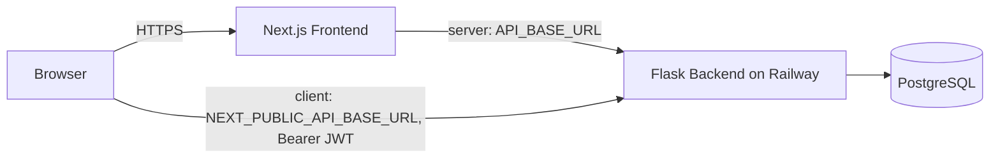

# Design Document

## Overview

RevoTask is a Trello-like task manager made of two deployables.

- **Backend**: Flask REST API (SQLAlchemy, Flask-Migrate, Flask-JWT-Extended, Marshmallow, PostgreSQL, Gunicorn) on Railway.
- **Frontend**: Next.js App Router application (React, TypeScript, Tailwind CSS, react-hot-toast) on Vercel.

Code examples use Python for the Backend and TypeScript for the Frontend.

Key design decisions:

| Decision | Choice | Reason |
|---|---|---|
| Card and Column ordering | `db.Column(db.Float)` order value | A move writes one row (R4.5, R30.5). The new order is the midpoint of the neighbours. |
| Deletion of Cards | Soft delete with `deleted_at` | R4.4 requires exclusion from later responses. |
| Response format | Envelope `{"data": ...}` / `{"error": "..."}` | R11.3. One error handler produces every error. |
| Layering | `routes.py` → `service.py` → models; `schema.py` for validation | R11.1, R11.2, R11.4. |
| Auth state on Frontend | JWT in AuthContext React state only | R21.8. Not written to localStorage. |
| Drag and drop | Native HTML5 events, optimistic update | R15.1, R15.2. |

### Delivery ordering constraint (guidelines first)

R23.6 requires the Guideline_Set (`/guidelines/frontend.md`, `backend.md`, `database.md`) to be committed before any Backend or Frontend code. The Repository history must follow this order:

1. `specs`: `/specs` files and `.gitignore`.
2. `guidelines`: `/guidelines` files, including the before/after AI output comparison and the violation report (at least 3 violations).
3. `backend`: first commit with Backend code. It must come after commit 2.
4. `frontend`: first commit with Frontend code. It must come after commit 2.
5. `tests`, then `deployment` and README.

No file under `backend/` or `frontend/` may be added in commits 1 and 2. This can be verified with `git log --diff-filter=A --format=%H -- backend frontend` and comparing the first result against the guidelines commit.

## Architecture



Backend layout:

```
backend/
  app/
    __init__.py          # create_app, CORS, JWT, error handlers
    extensions.py        # db, migrate, jwt
    models/              # User, Board, Column, Card, Comment, Notification
    common/              # envelope.py, errors.py, access.py
    auth/ boards/ columns/ cards/ comments/ notifications/ analytics/ users/
      routes.py  service.py  schema.py
    health.py            # GET /api/health
  migrations/
  wsgi.py                # gunicorn wsgi:app
```

Frontend layout:

```
frontend/src/
  app/
    layout.tsx
    page.tsx                   # /            (Server Component)
    login/page.tsx             # /login
    register/page.tsx          # /register
    boards/[id]/page.tsx       # /boards/[id] (Server Component)
    my-tasks/page.tsx          # /my-tasks
    profile/page.tsx           # /profile
  components/  BaseButton BaseBadge BaseModal CardDetailModal CommentList NotificationBell
  hooks/       useDragAndDrop useNotifications useErrorHandler
  lib/         apiClient.ts errors.ts toast.ts order.ts
  context/     AuthContext.tsx
```

## Routes and Pages

### Backend routes

All routes are under `/api`. "JWT" means `@jwt_required()`.

| # | Method and path | Blueprint | JWT | Success | Error statuses |
|---|---|---|---|---|---|
| B1 | POST /api/auth/register | auth | no | 201 User | 400, 409 |
| B2 | POST /api/auth/login | auth | no | 200 JWT | 400, 401 |
| B3 | POST /api/boards | boards | yes | 201 Board | 400, 401 |
| B4 | GET /api/boards | boards | yes | 200 Board list | 401 |
| B5 | GET /api/boards/<id> | boards | yes | 200 Board with Columns and Cards | 401, 403, 404 |
| B6 | PATCH /api/boards/<id> | boards | yes | 200 Board | 400, 401, 403, 404 |
| B7 | DELETE /api/boards/<id> | boards | yes | 200 | 401, 403, 404 |
| B8 | POST /api/boards/<id>/columns | columns | yes | 201 Column | 400, 401, 403, 404 |
| B9 | PATCH /api/boards/<id>/columns/reorder | columns | yes | 200 Column list | 400, 401, 403, 404 |
| B10 | PATCH /api/columns/<id> | columns | yes | 200 Column | 400, 401, 404 |
| B11 | DELETE /api/columns/<id> | columns | yes | 200 | 401, 404 |
| B12 | POST /api/columns/<id>/cards | cards | yes | 201 Card | 400, 401, 404 |
| B13 | GET /api/cards?assignee=me or ?search=<term> | cards | yes | 200 Card list | 400, 401 |
| B14 | PATCH /api/cards/<id> | cards | yes | 200 Card | 400, 401, 404 |
| B15 | DELETE /api/cards/<id> | cards | yes | 200 | 401, 404 |
| B16 | PATCH /api/cards/<id>/position | cards | yes | 200 Card | 400, 401, 404 |
| B17 | POST /api/cards/<id>/comments | comments | yes | 201 Comment | 400, 401, 404 |
| B18 | GET /api/cards/<id>/comments | comments | yes | 200 Comment list | 401, 404 |
| B19 | PATCH /api/comments/<id> | comments | yes | 200 Comment | 400, 401, 403, 404 |
| B20 | DELETE /api/comments/<id> | comments | yes | 200 | 401, 403, 404 |
| B21 | GET /api/notifications?page&per_page | notifications | yes | 200 page | 400, 401 |
| B22 | PATCH /api/notifications/<id>/read | notifications | yes | 200 Notification | 401, 403, 404 |
| B23 | GET /api/boards/<id>/analytics | analytics | yes | 200 statistics | 401, 403, 404 |
| B24 | GET /api/users/me | users | yes | 200 profile | 401 |
| B25 | PATCH /api/users/me | users | yes | 200 profile | 400, 401, 409 |
| B26 | GET /api/health | (app) | no | 200 `{"data":{"status":"ok"}}` | none |

Every route can also return 500 from the global handler (R11.6).

### Frontend pages

| # | Path | Rendering | Protected | Calls |
|---|---|---|---|---|
| P1 | /register | Client Component | no | B1, then redirect to /login |
| P2 | /login | Client Component | no | B2, stores JWT in AuthContext, redirect to / |
| P3 | / (dashboard) | Server Component with a client create-board form | yes | B4, B3 |
| P4 | /boards/[id] (Kanban) | Server Component with client children | yes | B5, B8, B12, B16, B23, B17, B18, B19, B20 |
| P5 | /my-tasks | Client Component | yes | B13 (`assignee=me`, `search=<term>`) |
| P6 | /profile | Client Component | yes | B24, B25 |

The NotificationBell is part of the shared layout and calls B21 and B22. Protected pages redirect to /login when AuthContext has no JWT (R12.6).

## Components and Interfaces

### Backend

Envelope helpers (`common/envelope.py`):

```python
def ok(data, status=200):
    return jsonify({"data": data}), status

def fail(message: str, status: int):
    return jsonify({"error": message}), status
```

Error handling (`common/errors.py`). A single `AppError(message, status)` is raised by services. Handlers map `AppError`, Marshmallow `ValidationError` (400), JWT errors (401) and any `Exception` (500, fixed message "Internal server error", no traceback in the body; the traceback goes to the server log only).

Access control (`common/access.py`):

```python
def get_accessible_board(board_id: str, user_id: str) -> Board:
    board = db.session.get(Board, board_id)
    if board is None:
        raise AppError("Board not found", 404)
    if board.owner_id != user_id:
        raise AppError("Forbidden", 403)
    return board
```

Not-found is checked before ownership, so 404 and 403 are unambiguous (R2.6, R2.7, R8.3, R8.4).

Card position (`cards/schema.py`, `cards/service.py`):

```python
class CardPositionSchema(Schema):
    column_id = fields.UUID(required=True)
    order = fields.Float(required=True, validate=validate.Range(min=0, min_inclusive=False))

def move_card(card_id, payload, user_id) -> Card:
    data = CardPositionSchema().load(payload)          # 400 on failure
    card = get_live_card_or_404(card_id)                # deleted_at IS NULL
    column = get_column_or_404(data["column_id"])
    card.column_id, card.order = column.id, data["order"]
    db.session.commit()                                 # one row updated
    return card
```

Search (`cards/service.py`) uses `Card.title.ilike(f"%{escaped}%")` or the same on `description` with bound parameters. `%` and `_` in the term are escaped. Empty or whitespace-only terms raise `AppError(..., 400)`. Every query adds `Card.deleted_at.is_(None)`.

Analytics (`analytics/service.py`) joins `Column`, `Card`, and `User` (assignee or comment author) to return `cards_per_column`, `completed_this_week` and `activity_per_member`. A card counts as completed this week when it sits in the board's last Column by order and `updated_at` is within the current ISO week. This definition is an assumption because the requirements do not define "completed".

Notifications are created by services: assigning a Card to a User and commenting on a Card the User is assigned to. This is an assumption; the requirements specify only the read and list behaviour.

Security configuration (`create_app`): `JWT_SECRET_KEY` and `DATABASE_URL` come from environment variables; CORS allows only `FRONTEND_ORIGIN`; passwords use `werkzeug.security.generate_password_hash` (salted); all database access goes through SQLAlchemy bound parameters.

### Frontend

`apiClient.ts`:

```ts
export class ApiError extends Error {
  constructor(public status: number, message: string) { super(message); }
}

const baseUrl = () =>
  typeof window === "undefined" ? process.env.API_BASE_URL! : process.env.NEXT_PUBLIC_API_BASE_URL!;

export async function apiClient<T>(path: string, opts: RequestInit & { token?: string | null } = {}): Promise<T> {
  const headers = new Headers(opts.headers);
  headers.set("Content-Type", "application/json");
  if (opts.token) headers.set("Authorization", `Bearer ${opts.token}`);
  const res = await fetch(`${baseUrl()}${path}`, { ...opts, headers });
  const body = await res.json().catch(() => ({}));
  if (!res.ok) throw new ApiError(res.status, body.error ?? res.statusText);
  return body.data as T;
}
```

Server Components (/ and /boards/[id]) need the JWT on the server. Because AuthContext is client-only state (R21.8), the Server Component pages fetch their initial data through a thin client wrapper that reads the token from AuthContext, or the page receives the token from a client boundary. The design keeps the page shell as a Server Component and passes the fetched data to client children. This is the main risk in the Frontend design and is noted in Error Handling.

Order computation (`lib/order.ts`):

```ts
export function computeOrder(prev: number | null, next: number | null): number {
  if (prev === null && next === null) return 1024;
  if (prev === null) return next! / 2;
  if (next === null) return prev + 1024;
  return (prev + next) / 2;
}
```

The result is strictly between the neighbours (R15.3) and positive when `next > 0` (R4.6).

`useDragAndDrop` uses `onDragStart`, `onDragOver` and `onDrop`. On drop it saves a snapshot of the board state, applies the new `{column_id, order}` locally, then calls B16. On `ApiError` it restores the snapshot and calls `useErrorHandler`.

`useErrorHandler` maps a status to a message through `errors.ts` and shows it with `toast.ts` (react-hot-toast). Status 401 also clears the JWT in AuthContext and routes to /login.

`useNotifications` polls B21 every 30 000 ms with `setInterval` and clears the interval on unmount or sign-out. It exposes `unreadCount` and `markRead(id)`. NotificationBell renders the count in BaseBadge and hides it when the count is 0.

Shared components: `BaseButton` (variants `primary | secondary | destructive`; ignores clicks while `disabled`), `BaseBadge` (text label), `BaseModal` (titled overlay, close control, closes on Escape), `CardDetailModal` (BaseModal containing CommentList), `CommentList` (loads B18, posts B17, shows edit/delete only when `comment.user_id === currentUser.id`).

Search debounce: a `useDebouncedValue(term, 300)` hook feeds B13 on /my-tasks. Mobile support (R27.5): Tailwind responsive classes, columns scroll inside their own container at 375 px, no fixed widths over 100% of the viewport.

## Data Models

All primary keys are UUIDs. All tables have `created_at` and `updated_at`.

```python
class Card(db.Model):
    __tablename__ = "cards"
    id          = db.Column(UUID(as_uuid=True), primary_key=True, default=uuid.uuid4)
    column_id   = db.Column(UUID(as_uuid=True), db.ForeignKey("columns.id"), nullable=False, index=True)
    title       = db.Column(db.String(200), nullable=False)
    description = db.Column(db.Text)
    assignee_id = db.Column(UUID(as_uuid=True), db.ForeignKey("users.id"), index=True)
    order       = db.Column(db.Float, nullable=False)
    created_at  = db.Column(db.DateTime(timezone=True), nullable=False, default=utcnow)
    updated_at  = db.Column(db.DateTime(timezone=True), nullable=False, default=utcnow, onupdate=utcnow)
    deleted_at  = db.Column(db.DateTime(timezone=True), nullable=True)
```

| Table | Columns besides id, created_at, updated_at |
|---|---|
| users | name, email (unique), password_hash |
| boards | title, owner_id → users |
| columns | board_id → boards (cascade delete), title, order (Float) |
| cards | see model above |
| comments | card_id → cards, user_id → users, text |
| notifications | user_id → users, message, read (bool, default false) |

Indexes: `cards(column_id, order)`, `cards(assignee_id)`, `columns(board_id, order)`, `comments(card_id)`, `notifications(user_id, read)`. Schema changes go through Flask-Migrate; Railway runs `flask db upgrade` before starting `gunicorn wsgi:app` (R27.1, R27.2).

Float precision: repeated midpoint insertion between the same two neighbours exhausts double precision after roughly 50 inserts. R30.5 forbids touching other rows during a move, so no rebalancing is done in a move. This is accepted for the project scope.

Notable response shapes:

```json
{"data": {"id": "uuid", "column_id": "uuid", "title": "…", "order": 1536.0, "updated_at": "…"}}
{"data": {"cards_per_column": [{"column_id": "uuid", "count": 3}],
          "completed_this_week": 2,
          "activity_per_member": [{"user_id": "uuid", "name": "…", "comments": 4, "cards_updated": 7}]}}
{"error": "Forbidden"}
```

## Acceptance Criteria Traceability

Route and page identifiers refer to the tables above. "—" marks a criterion that describes a repository, test, deployment or documentation deliverable. It has no route or page of its own, and the right column names the artefact or the routes it exercises.

| AC | Route / page |
|---|---|
| 1.1, 1.2, 1.3 | B1 |
| 1.4, 1.5 | B2 |
| 1.6 | B1 (hash stored), B2 (hash verified) |
| 1.7 | B3–B25 (every JWT route) |
| 2.1 | B3 |
| 2.2 | B4 |
| 2.3 | B5 |
| 2.4 | B6 |
| 2.5 | B7 |
| 2.6, 2.7 | B5, B6, B7 |
| 3.1, 3.5, 3.6 | B8 (3.5 and 3.6 also B9–B11) |
| 3.2 | B10 |
| 3.3 | B11 |
| 3.4 | B9 |
| 4.1 | — (Card model, `cards` table), exercised by B12, B14–B16 |
| 4.2 | B12 |
| 4.3 | B14 |
| 4.4 | B15 (exclusion seen in B5, B13, B14, B16) |
| 4.5, 4.6 | B16 |
| 4.7 | B14, B15, B16 |
| 5.1, 5.2, 5.4 | B13 |
| 5.3 | P5 (also P4 if it hosts a search field; the requirement names only the "Frontend search field") |
| 6.1 | B17 |
| 6.2 | B18 |
| 6.3 | B19 |
| 6.4 | B20 |
| 6.5 | B17, B19 |
| 6.6 | B17–B20 |
| 6.7 | B19, B20 |
| 7.1, 7.4 | B21 |
| 7.2, 7.3 | B22 |
| 8.1, 8.2, 8.3, 8.4 | B23 |
| 9.1 | B24 |
| 9.2, 9.3, 9.4 | B25 |
| 10.1 | B26 |
| 11.1, 11.2, 11.5 | — (Backend structure and migrations; all of B1–B26) |
| 11.3, 11.4, 11.6 | B1–B26 |
| 12.1, 12.3 | P1 (calls B1) |
| 12.2, 12.4 | P2 (calls B2) |
| 12.5 | P1, P2 |
| 12.6 | P3, P4, P5, P6 |
| 13.1, 13.4 | P3 |
| 13.2 | P3 (calls B3) |
| 13.3 | P3 → P4 |
| 14.1, 14.6 | P4 (calls B5) |
| 14.2 | P4 (calls B8) |
| 14.3 | P4 (calls B12) |
| 14.4 | P4 (CardDetailModal) |
| 14.5 | P4 (calls B23) |
| 15.1, 15.2, 15.3, 15.4 | P4 (calls B16) |
| 16.1, 16.2, 16.3, 16.4, 16.5, 16.6 | P4 (CardDetailModal; calls B17, B18, B19, B20) |
| 17.1, 17.2, 17.3, 17.4 | P5 (calls B13) |
| 18.1, 18.2, 18.3 | P6 (calls B24, B25) |
| 19.1, 19.2, 19.3, 19.4, 19.5 | NotificationBell in shared layout on P3–P6 (calls B21, B22) |
| 20.1, 20.2, 20.3, 20.4 | — (shared components used by P1–P6) |
| 21.1–21.8 | — (apiClient, AuthContext and useErrorHandler used by P1–P6; 21.7 redirects to P2) |
| 22.1–22.5 | — (Spec_Set deliverable; this table satisfies 22.3) |
| 23.1–23.6 | — (Guideline_Set deliverable; 23.6 is the ordering constraint in the Overview) |
| 24.1, 24.2 | — (pytest suite over B1–B26; 24.2 covers B17–B20) |
| 25.1, 25.2 | — (Jest and React Testing Library over shared components and P4 children) |
| 26.1–26.5 | — (Playwright over P1, P2, P3, P4; the 8-step journey uses B16 persistence) |
| 27.1, 27.2, 27.4 | — (Railway and Vercel deployment) |
| 27.3 | B26, B1, B2 |
| 27.5 | P1–P6 |
| 28.1, 28.2, 28.3 | — (Repository) |
| 29.1 | — (README) |
| 30.1 | B1–B22, B24–B26 |
| 30.2, 30.3, 30.4 | B1–B26 (application configuration) |
| 30.5 | B16 |

## Error Handling

| Condition | Layer | Result |
|---|---|---|
| Marshmallow `ValidationError` | Backend global handler | 400 `{"error": "<field messages>"}` |
| Duplicate email (register, profile) | auth / users service | 409 |
| Missing, expired or invalid JWT | Flask-JWT-Extended callbacks | 401 |
| Wrong credentials | auth service | 401, same message for unknown email and wrong password |
| Not owner of Board or Comment, or Notification of another User | service | 403 |
| Unknown or soft-deleted resource | service | 404 |
| Invalid `page`/`per_page`, empty `search` | schema or service | 400 |
| Any other exception | Backend global handler | 500 `{"error": "Internal server error"}`, no stack trace |
| Non-2xx response | apiClient | throws `ApiError(status, message)` |
| ApiError in a component | useErrorHandler | toast; on 401 also clears JWT and goes to /login |
| Position update fails after optimistic drop | useDragAndDrop | restore snapshot, error toast |

Risks:

- Server Components need the JWT, which lives only in client state (R21.8). A page reload clears it, so the user returns to /login. Accepted by the requirements.
- Moving a Card to a Column of a Board the User does not own is not covered by R4.5. The service checks Board ownership through the target Column and returns 403 (assumption).

## Correctness Properties

*A property is a characteristic or behavior that should hold true across all valid executions of a system-essentially, a formal statement about what the system should do. Properties serve as the bridge between human-readable specifications and machine-verifiable correctness guarantees.*

Redundant candidates were merged as follows. Register 201 and login success combine into one round trip. Duplicate email and invalid payload checks are kept separate because their statuses differ. 401, 403 and 404 checks over all routes collapse into three cross-route properties. Comment owner-only update and delete combine with the 403 case. Notification 403 merges into the general ownership property. Unread count display and hide-at-zero merge into one property. Board 404 and 403 for analytics merge into the access properties. Position persistence (4.5) subsumes reload persistence (14.6) at the API level.

### Property 1: Register then login round trip

For any valid name, email and password, registering returns 201 with a User that has no password field, and logging in with the same email and password returns 200 with a JWT that authenticates GET /api/users/me as that User.

**Validates: Requirements 1.1, 1.4, 9.1**

### Property 2: Duplicate email is rejected

For any registered User and any attempt to register, or to update a profile to, that email, the response is 409 and the stored Users are unchanged.

**Validates: Requirements 1.2, 9.4**

### Property 3: Invalid payloads are rejected with 400

For any route that accepts a payload and any payload that violates its Marshmallow schema (missing fields, wrong types, empty title, empty or whitespace search term, non-positive or non-integer `page`/`per_page`), the response is 400 with an error Envelope and no data is changed.

**Validates: Requirements 1.3, 3.5, 5.4, 6.5, 7.4, 11.4**

### Property 4: Wrong credentials are rejected

For any email and password pair that does not match a registered User, POST /api/auth/login returns 401 with an error Envelope.

**Validates: Requirements 1.5**

### Property 5: Passwords are salted hashes

For any password, the stored value differs from the password, verifies against it, and two Users registered with the same password have different stored values.

**Validates: Requirements 1.6**

### Property 6: Protected routes require a valid JWT

For any protected route and any request with a missing, malformed, tampered or expired JWT, the response is 401 with an error Envelope.

**Validates: Requirements 1.7, 6.6**

### Property 7: Resource ownership is enforced

For any two distinct Users A and B, and any Board, Comment or Notification owned by A, B's requests to read, change or delete it (Board GET, PATCH, DELETE, analytics; Comment PATCH, DELETE; Notification read) return 403, and the resource is unchanged. The same requests by A succeed.

**Validates: Requirements 2.7, 6.3, 6.4, 6.7, 7.3, 8.4**

### Property 8: Unknown identifiers return 404

For any route with an identifier in the URL and any UUID that matches no live resource (including soft-deleted Cards), the response is 404 with an error Envelope.

**Validates: Requirements 2.6, 3.6, 4.7, 8.3**

### Property 9: Board create and fetch round trip

For any User and any set of Boards, Columns and Cards created through the API, GET /api/boards returns exactly that User's Boards, and GET /api/boards/<id> returns the Board with all of its Columns and live Cards nested.

**Validates: Requirements 2.1, 2.2, 2.3, 4.2**

### Property 10: Board update applies the given fields

For any Board and any valid field set, PATCH /api/boards/<id> returns a Board with those field values, and a following GET returns the same values.

**Validates: Requirements 2.4**

### Property 11: Column reorder round trip

For any Board with Columns and any valid assignment of distinct Float order values, PATCH reorder followed by GET returns the Columns sorted by the new values.

**Validates: Requirements 3.1, 3.4**

### Property 12: Card position persists and touches one row

For any Card and any valid `{column_id, order}` payload, PATCH /api/cards/<id>/position returns 200, a later GET shows the Card in that Column with that order, and every other Card row, including its order value, is unchanged.

**Validates: Requirements 4.5, 14.6, 30.5**

### Property 13: Position schema accepts only valid payloads

For any payload, CardPositionSchema accepts it if and only if `column_id` is a UUID string and `order` is a positive float. Otherwise the route returns 400.

**Validates: Requirements 4.6**

### Property 14: Card update refreshes `updated_at`

For any Card and any valid update, the returned Card has the new field values and an `updated_at` not earlier than before, and `created_at` is unchanged.

**Validates: Requirements 4.3**

### Property 15: Soft-deleted Cards never appear

For any Card that has been deleted, no response from B5, B13, B14, B16 or B18 includes it, and its row has a non-null `deleted_at`.

**Validates: Requirements 4.4**

### Property 16: Assignee filter

For any set of Cards with assorted assignees, GET /api/cards?assignee=me returns exactly the live Cards assigned to the requesting User.

**Validates: Requirements 5.1**

### Property 17: Search is case-insensitive and complete

For any set of Cards and any non-empty term, GET /api/cards?search=<term> returns exactly the live Cards whose title or description contains the term ignoring case, including when the term contains `%`, `_` or quotes.

**Validates: Requirements 5.2, 30.4**

### Property 18: Search debounce

For any sequence of keystrokes with gaps, the Frontend sends one request per quiet period of at least 300 ms, carrying the latest term, and sends no request while the gap since the last keystroke is under 300 ms.

**Validates: Requirements 5.3, 17.2**

### Property 19: Comment create and list round trip

For any Card and any sequence of valid comment texts posted by authenticated Users, GET /api/cards/<id>/comments returns all of them with the correct authors and texts.

**Validates: Requirements 6.1, 6.2**

### Property 20: Comment owner can edit and delete

For any Comment and any valid new text, its owner's PATCH returns the new text, and the owner's DELETE returns 200 after which the Comment is absent from the list.

**Validates: Requirements 6.3, 6.4**

### Property 21: Notification pagination partitions the set

For any User with N Notifications and any positive `per_page`, concatenating pages 1…ceil(N / per_page) returns each of that User's Notifications exactly once, no page has more than `per_page` items, and no other User's Notifications appear.

**Validates: Requirements 7.1**

### Property 22: Marking read is idempotent

For any owned Notification, marking it read once or several times leaves it read, and the User's unread count drops by one only on the first call.

**Validates: Requirements 7.2**

### Property 23: Analytics matches a reference model

For any Board with Columns, Cards, Users and activity, the analytics response equals the result computed by a plain in-memory reference implementation over the same data.

**Validates: Requirements 8.1**

### Property 24: Profile update changes only name and email

For any User and any PATCH payload that may contain `name`, `email`, `password` and other fields, only name and email change, the stored password hash is unchanged, and the response has no password field.

**Validates: Requirements 9.2, 9.3**

### Property 25: Envelope on every response

For any route and any request (success, validation failure, auth failure, missing resource, or injected unhandled exception), the body is a JSON object with exactly one of the keys `data` or `error`, and a 500 body contains no stack trace text.

**Validates: Requirements 11.3, 11.6**

### Property 26: Unauthenticated users are redirected

For any protected page path and any AuthContext state without a JWT, the Frontend redirects to /login.

**Validates: Requirements 12.6**

### Property 27: Board display order

For any list of Columns and Cards with arbitrary Float order values, the rendering function returns Columns and, within each Column, Cards in ascending order value.

**Validates: Requirements 14.1**

### Property 28: Optimistic move, then revert on failure

For any board state and any drop, the displayed state shows the Card at its target before the API responds. If the API call fails, the displayed state equals the state before the drop and an error toast is raised.

**Validates: Requirements 15.2, 15.4**

### Property 29: Computed order lies between neighbours

For any two neighbour order values `prev < next` (or an absent neighbour at either end), `computeOrder` returns a value strictly between them, and a positive value whenever `next` is positive.

**Validates: Requirements 15.3, 4.6**

### Property 30: Comment controls follow ownership

For any list of Comments and any signed-in User, CommentList shows edit and delete controls on exactly the Comments authored by that User.

**Validates: Requirements 16.4, 16.5**

### Property 31: Unread badge reflects the count

For any unread count n, NotificationBell shows n when n > 0 and hides the badge when n = 0. For any n > 0, marking one Notification as read results in a displayed count of n − 1.

**Validates: Requirements 19.1, 19.3, 19.4**

### Property 32: Bearer header is sent when a JWT exists

For any JWT string and request path, apiClient sends `Authorization: Bearer <jwt>`. With no JWT it sends no Authorization header.

**Validates: Requirements 21.4**

### Property 33: Non-2xx responses throw ApiError

For any status outside 200–299 and any error body, apiClient throws an ApiError carrying that status and the body's error message. For any 2xx status, it returns the `data` value.

**Validates: Requirements 21.5**

### Property 34: Every status maps to a toast message

For any ApiError status code, useErrorHandler produces a non-empty message through `errors.ts`. For status 401 it also clears the JWT and redirects to /login.

**Validates: Requirements 21.6, 21.7**

Criteria not covered by a property are tested by examples, smoke checks or integration tests: page and component rendering (12.1–12.5, 13.x, 14.2–14.5, 16.1–16.3, 16.6, 17.1, 17.3, 17.4, 18.x, 19.2, 19.5, 20.x), structure and configuration (4.1, 8.2, 11.1, 11.2, 11.5, 15.1, 21.1–21.3, 21.8, 30.2, 30.3), health (10.1), deliverables (22–29), and latency (30.1).

## Testing Strategy

**Dual approach.** Example tests cover specific scenarios and integration points. Property tests cover the universal properties above. Both are required.

**Backend (pytest -v).** Property tests use Hypothesis with a minimum of 100 examples each. They run against the Flask test client with a transactional SQLite or PostgreSQL test database that is reset between examples. Properties 1–17, 19–25 live here. The comments suite must assert 201, 400, 401 and 403 (R24.2). Example tests cover B26, delete responses, Card model fields and Blueprint file structure.

**Frontend (npm test).** Jest and React Testing Library, with fast-check for Properties 18, 26–34 and a minimum of 100 runs each. Fake timers cover debounce and polling. Example tests cover BaseButton, BaseModal, CardDetailModal and NotificationBell (R25.2), page forms and toasts.

**End-to-end.** Playwright against the live Vercel URL: 4 auth scenarios and an 8-step Kanban journey with drag and drop and a reload check. It waits on observable conditions and never calls `waitForTimeout`. The HTML report is committed.

**Integration and smoke.** Postman checks B26, B1 and B2 against Railway. A p95 latency check covers R30.1. A git-history check verifies the guidelines-first order. Mobile viewport checks run at 375 px.

**Tagging.** Each property test carries the tag `Feature: revotask, Property <n>: <property text>`.
